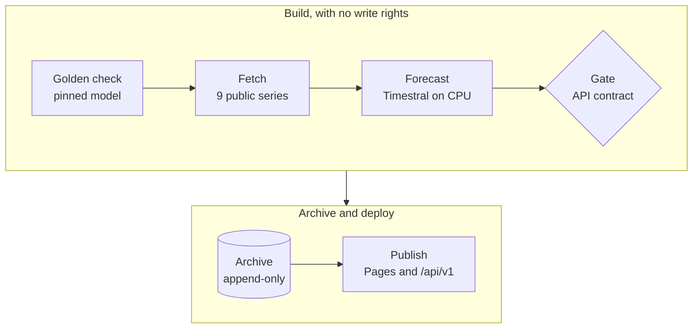

<div align="center">


aseri
=====

<h4>Daily probabilistic forecasts of geopolitical risk from nine public signals, made by Mistral's Timestral and scored against what happened.</h4>

[](https://github.com/exdsgift/aseri/actions/workflows/daily.yml)
[](LICENSE)
[](https://creativecommons.org/licenses/by-nc/4.0/)
[](https://huggingface.co/mistralai/Timestral-209M)<br>
[](https://docs.hubverse.io/en/latest/user-guide/model-output.html)
[](https://exdsgift.github.io/aseri/)
[](https://exdsgift.github.io/aseri/api/)

[Live site](https://exdsgift.github.io/aseri/)&nbsp;&nbsp;&nbsp;|&nbsp;&nbsp;&nbsp;[API](https://exdsgift.github.io/aseri/api/)&nbsp;&nbsp;&nbsp;|&nbsp;&nbsp;&nbsp;[Methods](docs/superpowers/specs/2026-10-29-aseri-design.md)&nbsp;&nbsp;&nbsp;|&nbsp;&nbsp;&nbsp;[Contributing](CONTRIBUTING.md)&nbsp;&nbsp;&nbsp;|&nbsp;&nbsp;&nbsp;[Citation](#citation)

</div>

---

## Latest News

- **[2026/11]** **[Bulk downloads](https://exdsgift.github.io/aseri/api/v1/bulk/datapackage.json)**: every forecast, value and score as Hubverse tables in Parquet and CSV, with a Frictionless data package that carries each file's licences ([#136](https://github.com/exdsgift/aseri/issues/136)).
- **[2026/11]** **[Calibrated bands](docs/adr/0001-baselines-and-calibration-before-the-live-record.md)**: the calibration layer of ADR 0001 is live as the model `aseri-timestral209m_c1` since the run of 2026-11-03 ([#151](https://github.com/exdsgift/aseri/issues/151)). On a two-year backtest its 8 in 10 range holds about 8 days in 10. A new model ID starts a new live record; the replay and the backtest record already show the calibrated forecasts.
- **[2026/11]** **[Public API v1](https://exdsgift.github.io/aseri/api/)**: an OpenAPI 3.1 contract, JSON Schemas, licence texts, Hubverse model metadata, and a gate that checks every file before each deploy ([#135](https://github.com/exdsgift/aseri/issues/135)).
- **[2026/11]** **[A page with less text](https://exdsgift.github.io/aseri/)**: each thing said once, on the chart ([#152](https://github.com/exdsgift/aseri/issues/152)), white on electric blue with three heroes in turn ([#150](https://github.com/exdsgift/aseri/issues/150)), and op-art margins ([#154](https://github.com/exdsgift/aseri/issues/154)).
- **[2026/11]** **[Nine series](#signals)**: Brent oil, "World War III" on Wikipedia, air-raid alerts and drones claimed join geopolitical risk and the four sea lanes ([#133](https://github.com/exdsgift/aseri/issues/133)).

<details>
<summary>Previous news</summary>

- **[2026/10]** **[A real-time GPR backtest](docs/research/gpr-realtime-backtest.md)**: 232 weekly origins from the authors' archived vintages, each scored against the value known 35 days later ([#145](https://github.com/exdsgift/aseri/issues/145)).
- **[2026/10]** **Track record**: WIS, the coverage of the 5 in 10 and 8 in 10 ranges, and the error against simple baselines, live and backtest apart ([#134](https://github.com/exdsgift/aseri/issues/134)).
- **[2026/10]** **Forecast archive**: every forecast appended to the `archive` branch in the Hubverse format, live and retrospective apart ([#129](https://github.com/exdsgift/aseri/issues/129)).
- **[2026/10]** **First daily forecast**: GPR forecast with Timestral-209M and published on GitHub Pages every day ([#127](https://github.com/exdsgift/aseri/issues/127)).

</details>

## Table of Contents

- [Overview](#overview)
- [Key Features](#key-features)
- [Signals](#signals)
- [How It Works](#how-it-works)
- [Model](#model)
- [Quick Start](#quick-start)
- [Track Record and Evaluation](#track-record-and-evaluation)
- [Contributing](#contributing)
- [License](#license)
- [Citation](#citation)
- [Acknowledgements](#acknowledgements)
- [Support](#support)

## Overview

焦り (*aseri*, "impatience, restlessness") answers one question in the first ten seconds: how unstable is the world right now, and where is it heading? Every day a GitHub Action fetches nine public series, from the Caldara and Iacoviello geopolitical risk index to four sea lanes and the air war in Ukraine, forecasts each new day of data with Mistral's Timestral-209M on CPU, archives every forecast append-only in the Hubverse format, scores past forecasts against what happened, and publishes a static page and a JSON API. No server, no database, no manual step. It is for awareness, not decision support.

## Key Features

- **Ranges, not points.** 21 quantile levels for every day ahead. The page shows where 8 in 10 days should land and draws possible paths, never a lone median line.
- **Calibrated.** Per-series offsets fitted on a two-year backtest, so the 8 in 10 range means 8 in 10 ([ADR 0001](docs/adr/0001-baselines-and-calibration-before-the-live-record.md)).
- **Append-only.** A dated forecast file is written once and never changed. Corrections go to the catalog's errata, and CI refuses any edit to an archived file.
- **An honest record.** Live forecasts and backtests are scored apart and never added together. A series shows its live score after 30 resolved forecasts.
- **Fails safe.** A source that fails, runs late or rewrites its history holds only its own series and opens an issue. The other series publish.
- **Pinned and traceable.** Weights and package pinned by revision, a golden-quantile check before every run, and provenance in every file: model, code commit, workflow run, each input's `as_of` and SHA-256.
- **Open and static.** Hubverse quantile semantics, OpenAPI 3.1 and JSON Schemas, CORS open, no key.
- **Bounded.** `master` holds code and docs only. The archive grows about 9 MB a year, under a 50 MB alarm.

## Signals

| Signal | Source | Unit | Horizon | Updates |
|---|---|---|---|---|
| Geopolitical risk<br>`gpr_daily` | [Caldara and Iacoviello, GPR daily](https://www.matteoiacoviello.com/gpr.htm) | index, 1985-2019 average = 100 | 28 days | Weekly, on Mondays; the last month is revised |
| "World War III"<br>`wiki_ww3_views` | [Wikimedia pageviews](https://pageviews.wmcloud.org/?project=en.wikipedia.org&platform=all-access&agent=user&pages=World_War_III) | Wikipedia views a day, people only | 14 days | Daily, a day late |
| Brent oil<br>`brent_spot` | [EIA, through FRED](https://fred.stlouisfed.org/series/DCOILBRENTEU) | $ a barrel | 14 trading days | Weekly batch on Wednesdays |
| Suez Canal<br>`suez_transits` | [IMF PortWatch](https://portwatch.imf.org/) | ships a day | 28 days | Weekly batch to a Sunday |
| Strait of Hormuz<br>`hormuz_transits` | IMF PortWatch | ships a day | 14 days | Weekly batch to a Sunday |
| Bab el-Mandeb<br>`bab_el_mandeb_transits` | IMF PortWatch | ships a day | 14 days | Weekly batch to a Sunday |
| Taiwan Strait<br>`taiwan_strait_transits` | IMF PortWatch | ships a day | 28 days | Weekly batch to a Sunday |
| Air-raid alerts, Ukraine<br>`ua_air_raid_hours` | [Ukrainian air raid sirens dataset](https://github.com/Vadimkin/ukrainian-air-raid-sirens-dataset), volunteer data | alert hours a day, all regions | 7 days | Daily |
| Drones downed<br>`ua_drones_downed_claimed` | [2022 Ukraine Russia War Dataset](https://github.com/PetroIvaniuk/2022-Ukraine-Russia-War-Dataset) | drones a day, claimed by Ukraine's General Staff | 7 days | Daily, with the General Staff's report |

The registry with every series' revision window, lag and evidence is [`pipeline/aseri/series.py`](pipeline/aseri/series.py).

## How It Works



At 07:00 UTC, [`daily.yml`](.github/workflows/daily.yml) runs the tests, then checks that the pinned model still gives its golden quantiles, so a dependency change never moves the numbers under the same model ID. It fetches each series, checks it against its source's contract, and forecasts every new day of data from the last observed day. A series that fails, runs late, rewrites its history beyond a normal update, or forecasts far outside its range is held alone: its last good forecast stays up, labelled, and the run opens an issue. The gate checks every API file against its schema before the archive job appends the new files and the site deploys. A push that changes only the page deploys in about 2 minutes, on the last run's API files.

## Model

| Property | Details |
|---|---|
| **Base model** | [Timestral-209M](https://huggingface.co/mistralai/Timestral-209M) by Mistral AI, a zero-shot time-series foundation model, revision `9874d25`, through the [`timestral`](https://github.com/mistralai/timestral) package at `a534bdb` |
| **Parameters** | 209,312,256 (837 MB of weights in fp32) |
| **Inference** | Univariate, the full history as context, 4 torch threads on CPU in a GitHub Actions `ubuntu-latest` runner; weights cached by revision |
| **Output** | 21 quantile levels, 0.01 to 0.99, for every day ahead; Hubverse `quantile` output |
| **Calibration** | Conformal offsets per series, bucket of steps and side of the median, fitted on a two-year backtest ([ADR 0001](docs/adr/0001-baselines-and-calibration-before-the-live-record.md)); none on Bab el-Mandeb |
| **Model ID** | `aseri-timestral209m_c1`, the calibrated model, live since 2026-11-03 ([#151](https://github.com/exdsgift/aseri/issues/151)). Every forecast file names the model that made it in `model_id`; earlier forecasts keep `aseri-timestral209m` |
| **Baselines** | Naive (the last value), seasonal naive (the same weekday a week back) and the 28-day mean; each series is judged against the one with the lowest error on its backtest |
| **Horizons** | 28 days for GPR, Suez and Taiwan; 14 for Hormuz, Bab el-Mandeb, "World War III" and Brent (trading days); 7 for the air-raid alerts and the drones |
| **Limits** | Mistral has not published the training cutoff, so backtests may be optimistic. Covariates were tested and none helped, so the daily forecasts use none; a monthly scout ([`scout.yml`](.github/workflows/scout.yml)) re-tests them and proposes any that pass, for a human to decide |

## Quick Start

### Using the API

Static JSON on GitHub Pages, updated once a day: poll at most once an hour.

```sh
API=https://exdsgift.github.io/aseri/api/v1
curl -s $API/series.json | jq -r '.series[].series_id'
curl -s $API/series/gpr_daily/latest.json | jq '{model_id, reference_date, target_end_date}'
curl -s $API/series/gpr_daily/scores.json | jq '{live: .live.n, needed: .min_n_to_display}'
```

```python
import json
from urllib.request import urlopen

BASE = "https://exdsgift.github.io/aseri/api/v1"
f = json.load(urlopen(f"{BASE}/series/hormuz_transits/latest.json"))
q = f["quantiles"]
for day, lo, mid, hi in zip(f["target_end_date"], q["0.1"], q["0.5"], q["0.9"]):
    print(f"{day}: likely {lo:.0f}-{hi:.0f} ships (8 in 10), middle estimate {mid:.0f}")
```

For research, everything is also in bulk, as Hubverse tables in Parquet and CSV: each year's forecasts, every value as first seen, the values scored against and every score. [`bulk/datapackage.json`](https://exdsgift.github.io/aseri/api/v1/bulk/datapackage.json) lists the files with their columns, licences and sources.

```python
import pandas as pd

forecasts = pd.read_parquet(f"{BASE}/bulk/forecasts-2026.parquet")
```

The [API page](https://exdsgift.github.io/aseri/api/) documents every file, the [OpenAPI 3.1 contract](https://exdsgift.github.io/aseri/api/v1/openapi.json) its shapes, and the [`archive`](https://github.com/exdsgift/aseri/tree/archive) branch holds every Hubverse round ever written.

### Running locally

Python 3.12 with [uv](https://docs.astral.sh/uv/), and Node 22 with npm. The first full run downloads 837 MB of weights and forecasts a 120-day backfill for every series, about a thousand forecasts, so give it a while on a laptop.

```sh
git clone https://github.com/exdsgift/aseri && cd aseri

# The pipeline
cd pipeline && uv sync
uv run pytest                                     # the tests
uv run python -m aseri ../site/api/v1 ../archive  # a full daily run

# The page
cd ../web && npm ci
npm run dev                                       # on the published API
```

## Track Record and Evaluation

- **What is scored.** Every forecast step, once its day's value has settled (35 days for GPR, which revises its last month), against that settled value.
- **How.** The weighted interval score (WIS) on the 21 levels, the share of days inside the 5 in 10 and 8 in 10 ranges, and the error of the middle estimate against the series' own simple baseline, by horizon bucket (1-7 and 8-28 days), each ratio with its 95% interval.
- **Live and backtest apart.** Live forecasts are issued by the daily run. Retrospective ones, the 120-day launch backfill and any day issued after the fact, are backtests. They are never added into one figure, and a series shows its live score only after 30 resolved forecasts.
- **One model per record.** A record scores one model's forecasts, named in its `scored_model_id`. After a model change, a series shows the previous model's record until the new model has a forecast scored 7 days ahead, which takes weeks for GPR, and the page says so.
- **Where.** [The Record on the live page](https://exdsgift.github.io/aseri/#record), and each series' `scores.json` in the API.

## Contributing

New series, new charts and fixes are welcome: start with [CONTRIBUTING.md](CONTRIBUTING.md). Propose a series with the [New series](https://github.com/exdsgift/aseri/issues/new?template=new-series.md) template, and report a problem with the [Bug](https://github.com/exdsgift/aseri/issues/new?template=bug.md) template.

## License

| Part | Licence |
|---|---|
| **Code** | [MIT](LICENSE) |
| **Forecasts, scores and the API** | [CC BY-NC 4.0](https://creativecommons.org/licenses/by-nc/4.0/), credited as each file's `license.attribution` says |
| **Data** | Each source's own terms, given per series in the [catalog](https://exdsgift.github.io/aseri/api/v1/series.json) and in [`api/licenses/`](api/licenses): GPR CC BY 4.0, Wikimedia pageviews CC0, Brent prices public domain (U.S. EIA), PortWatch under the IMF's terms (commercial use needs the IMF's permission), the two Ukraine datasets MIT |
| **Model** | Timestral's weights under Mistral AI's modified MIT licence; the `timestral` package Apache-2.0 |
| **Engravings** | CC0, from Wikimedia Commons |
| **Fonts** | DotGothic16, Jacquard 24 and Press Start 2P, all SIL Open Font License |

© 2026 Gabriele Durante

## Citation

If you use aseri's forecasts or code, cite it as below, and cite the data sources too: each series' attribution is in the [catalog](https://exdsgift.github.io/aseri/api/v1/series.json).

```bibtex
@misc{durante2026aseri,
  author       = {Durante, Gabriele},
  title        = {aseri: daily probabilistic forecasts of geopolitical risk},
  year         = {2026},
  howpublished = {\url{https://exdsgift.github.io/aseri/}},
  url          = {https://github.com/exdsgift/aseri}
}
```

## Acknowledgements

- **Data:** Dario Caldara and Matteo Iacoviello for the Geopolitical Risk Index; the Wikimedia Foundation for the pageviews API; the U.S. Energy Information Administration and FRED for Brent prices; the IMF and the UN Global Platform for PortWatch; Vadym Klymenko and the volunteers of the Ukrainian air raid sirens dataset; Petro Ivaniuk for the 2022 Ukraine Russia War Dataset.
- **Model:** Mistral AI for Timestral.
- **Format:** the [Hubverse](https://hubverse.io/) for the forecast format and its scoring conventions.
- **Engravings:** the National Gallery of Art (Hendrick Goltzius after Polidoro da Caravaggio, *Mercury*), The Metropolitan Museum of Art (Hendrick Goltzius, *The Farnese Hercules*) and the Rijksmuseum (*Apollo Belvedere*), through Wikimedia Commons.

## Support

<div align="center">

[GitHub](https://github.com/exdsgift)&nbsp;&nbsp;&nbsp;|&nbsp;&nbsp;&nbsp;[LinkedIn](https://www.linkedin.com/in/gabrieledurante/)&nbsp;&nbsp;&nbsp;|&nbsp;&nbsp;&nbsp;[Buy me a coffee](https://buymeacoffee.com/exdsgift)

</div>
