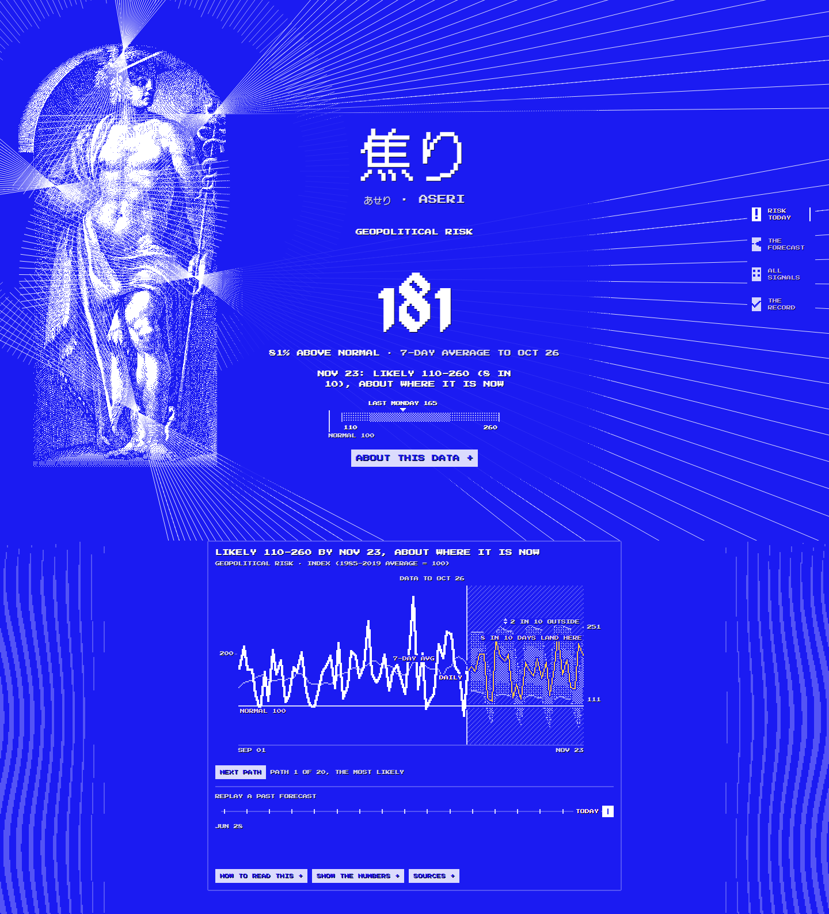
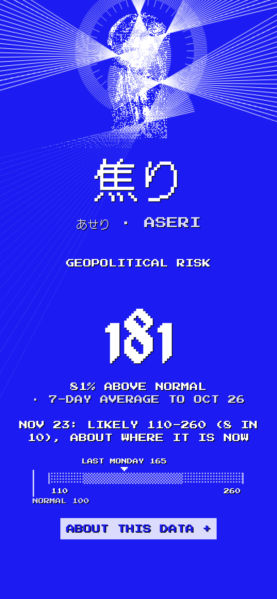

# Brand images

Images for aseri's profiles, posts and link previews, drawn by the site's own code: the
three heroes' art (Messenger, Signal, Vortex), the fonts (DotGothic16, Press Start 2P), the
tokens in `web/src/index.css`, the 1 px black shadow on every word and the op-art margins.
Nothing is drawn by hand, so a change to the site's art shows up here on the next run.

The art encodes a real value: GPR's 7-day average from the live API, as the hero does.
Mercury's fans open with it, Hercules' large frame is that many times the baseline's, and
Apollo's arm turns one degree per point. The images here were drawn on 2 November 2026
with **181** (the 7-day average to 26 October 2026, against a baseline of 100). Running
the script again redraws them with that day's value.

## The images

Every file is the platform's exact size. `@2x` files are the same image at twice the
pixels, for a screen that has them. An art pixel is 1 image pixel in the LinkedIn banner
and 2 everywhere else: a card shown at half its size keeps its pixels.

| Folder             | Files                                               | Size                   | Used for                                                      | Keep clear                                                                                                                                                                                                              |
| ------------------ | --------------------------------------------------- | ---------------------- | ------------------------------------------------------------- | ----------------------------------------------------------------------------------------------------------------------------------------------------------------------------------------------------------------------- |
| `linkedin-banner/` | `linkedin-banner-<hero>.png`, `@2x`                 | 1584 x 396             | LinkedIn profile background                                   | The left 40% of the lower half: LinkedIn's round profile photo covers it. The words and figures stay right of it, with only the ground, rays and stripes inside; Vortex's dial reaches about 90 px into its right edge. |
| `linkedin-banner/` | `linkedin-banner-<hero>-art.png`, `@2x`             | 1584 x 396             | The same, without words                                       | As above.                                                                                                                                                                                                               |
| `linkedin-banner/` | `linkedin-banner-messenger-line2.png`, `-line3.png` | 1584 x 396             | The banner with the alternative lines                         | As above.                                                                                                                                                                                                               |
| `linkedin-post/`   | `linkedin-post-<hero>.png`                          | 1200 x 627             | A link or image post in the LinkedIn feed                     | About 24 px at each edge.                                                                                                                                                                                               |
| `linkedin-post/`   | `linkedin-post-messenger-line2.png`, `-line3.png`   | 1200 x 627             | The post with the alternative lines                           | As above.                                                                                                                                                                                                               |
| `linkedin-post/`   | `linkedin-post-square-<hero>.png`                   | 1080 x 1080            | A square image post                                           | About 40 px at each edge.                                                                                                                                                                                               |
| `linkedin-post/`   | `linkedin-post-portrait-<hero>.png`                 | 1080 x 1350            | A portrait image post, the tallest the feed shows             | About 40 px at each edge.                                                                                                                                                                                               |
| `og/`              | `og-<hero>.png`                                     | 1200 x 630             | The site's Open Graph preview (`og:image`)                    | About 40 px at each edge. A few apps show only a centred square, which cuts the words.                                                                                                                                  |
| `x-header/`        | `x-header-<hero>.png`                               | 1500 x 500             | X profile header                                              | The lower left, under X's round profile photo, and about 60 px at the top and bottom, which some screens crop.                                                                                                          |
| `github-social/`   | `github-social-<hero>.png`                          | 1280 x 640             | GitHub's social preview (repository Settings, Social preview) | About 40 px at each edge.                                                                                                                                                                                               |
| `avatar/`          | `avatar-hat-400.png`, `avatar-hat-1024.png`         | 400 x 400, 1024 x 1024 | Profile picture or app icon: the winged hat, as the favicon   | The circle a platform crops to: the mark fills about 63% of the side, inside it.                                                                                                                                        |
| `avatar/`          | `avatar-kanji-400.png`, `avatar-kanji-1024.png`     | 400 x 400, 1024 x 1024 | The same with 焦                                              | As above.                                                                                                                                                                                                               |

`<hero>` is `messenger`, `signal` or `vortex`. The line is "Geopolitical risk, forecast
daily"; `line2` is "Daily forecasts of geopolitical risk, with an honest track record" and
`line3` "Open forecasts. Every one archived. Every miss shown."

## The favicon

The site's favicon is the hat of `avatar-hat`, the winged hat with the words' shadow on
the ground. At 16 px the avatar's drawing would blur, so `web/public/favicon.svg` redraws
the same hat on the 16 px grid, each wing a pixel narrower so that the hat and its shadow
fit with the ground round them. The script draws `favicon-16.png` and `favicon-32.png`
from it, and `apple-touch-icon.png` (180 px) from the avatar's own drawing, the hat 112 px
wide. `web/brand/hat.svg` keeps the first favicon's hat, which the avatars draw.

## The page

The live site, for this README and wherever a picture of the page helps: 1440 px wide,
from the top through the forecast panel, and an iPhone's first screen (390 px, WebKit),
with Messenger as the hero, under reduced motion and after the data has loaded.





## Regenerate

From `web/`, with the dependencies installed (`npm ci`):

```sh
npx playwright install chromium webkit   # once
node scripts/brand.mjs                   # every image, the favicons and the screenshots
node scripts/brand.mjs og-               # only the files whose path holds "og-"
node scripts/brand.mjs screenshots       # only the screenshots
```

The script starts the dev server, opens the brand page in Chromium once per image at the
image's scale, waits until the page has drawn its still frame (the one the motion ends on,
as under reduced motion), and writes the PNG here, or the favicons into `web/public/`.
Then it takes the screenshots of the live site. It reads the API, through the dev
server's proxy for the brand page, with the User-Agent
`aseri (+https://github.com/exdsgift/aseri)`. With
[oxipng](https://github.com/oxipng/oxipng) on the `PATH`, it then shrinks every file
without changing a pixel; without it, the files are about 40% larger.

## Where the code is

- `web/brand/formats.ts`: every format, its size, scale and layout, and the file list.
  Change a layout or add a format here.
- `web/brand/main.tsx` and `web/brand/index.html`: the brand page. It lays the real hero
  art out with its own layout code, moved to where the format puts it, and draws the veil
  behind the words as the hero does. Open it while `npm run dev` runs, at
  `/brand/index.html?format=og&hero=vortex` (or `&bare=1`, `&line=1`), or
  `/brand/index.html?avatar=hat&size=25`.
- `web/scripts/brand.mjs`: the script, with the screenshots' list.

The op-art margins are the site's own, `stripes` from `web/src/lib/margins.ts`, in a
scene sized for each image rather than for the site's column.

None of it is in the site's build: `vite.config.ts` builds only `index.html` and
`api/index.html`, and `web/src/index.css` keeps Tailwind from reading `web/brand` and
the script for class names.
