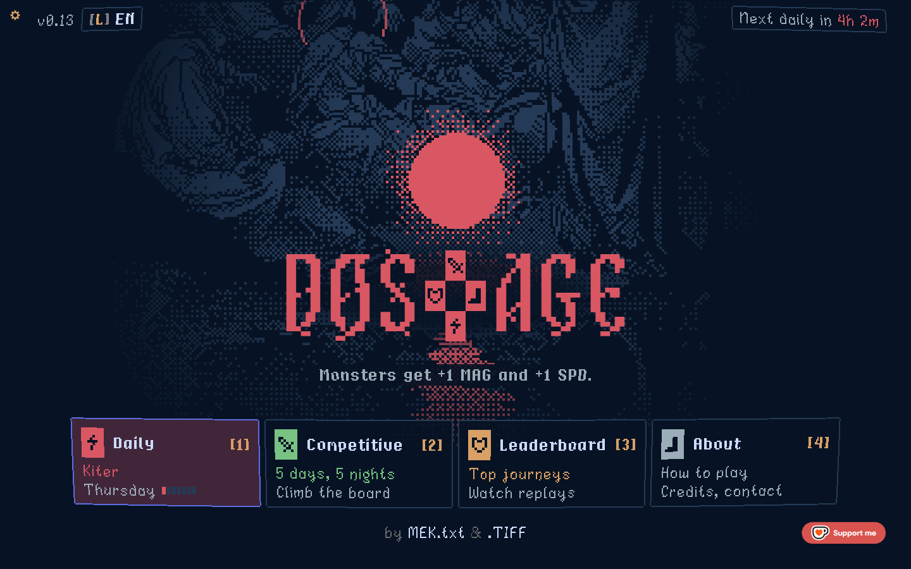
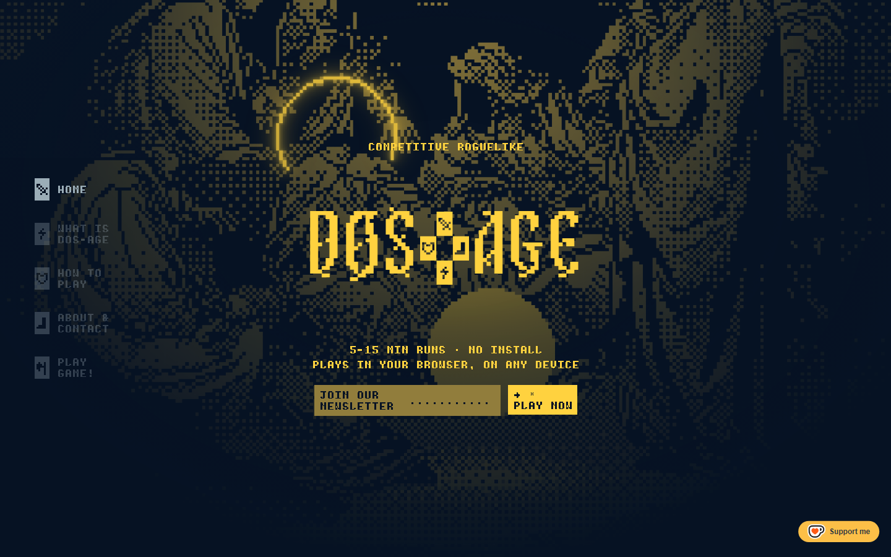
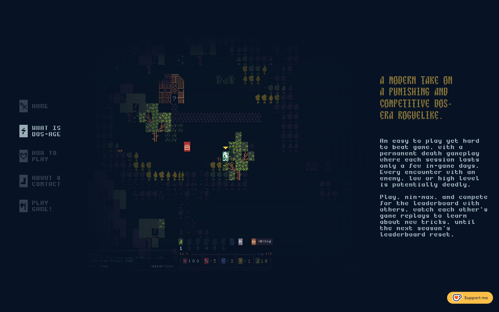
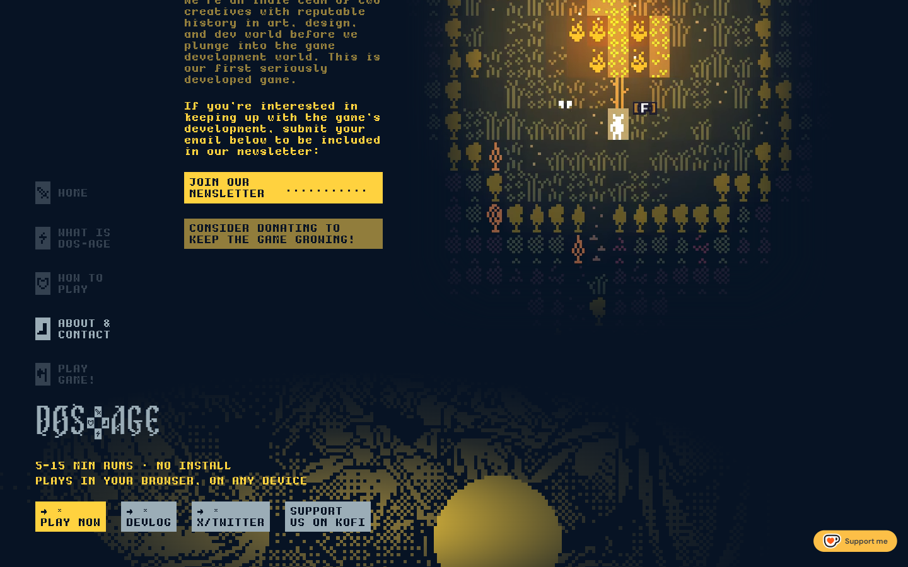
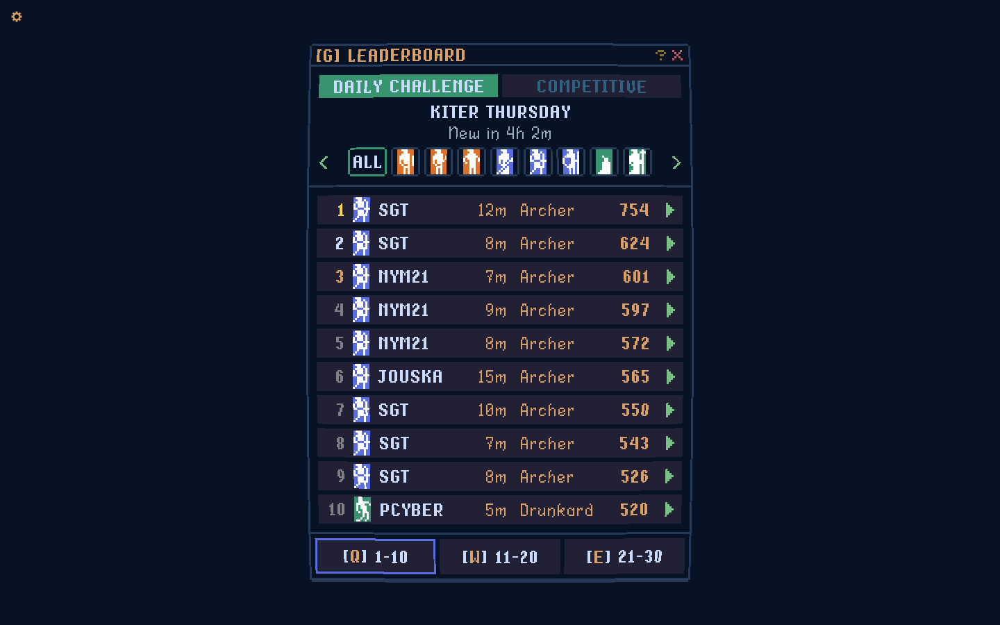
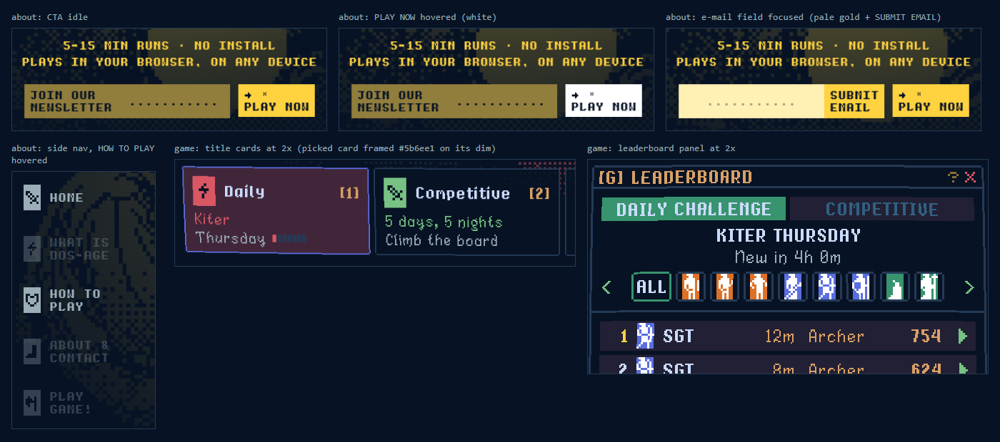
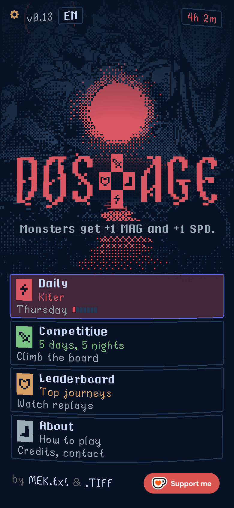
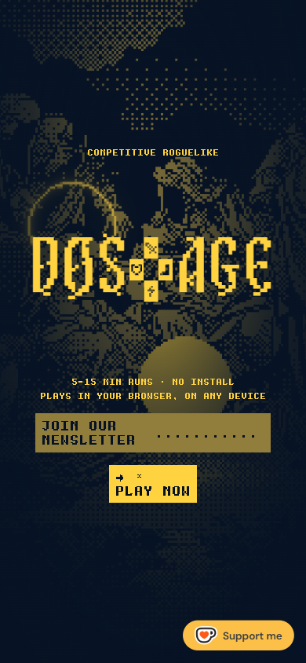

# Design study: dos-age.com and about.dos-age.com

Reference for the aseri UI. Captured 2026-10-29 with headless Chrome 156 (desktop 1440x900, phone 390x844 via device emulation), plus the served HTML, CSS and JS read as text. Values below come from the source unless marked "observed" (seen in a screenshot) or "inferred" (read from code, not seen).

Two very different pages share one design system by MEK.txt (Michael Alexander) and .TIFF (Tiffany Alexandra):

- **dos-age.com** is not a web page in the usual sense: it is the game itself, a full-screen `<canvas>` (2D, with a WebGL CRT pass over it). Its HTML is 7.6 KB; everything visible on the title screen is drawn by `title.js` and `game.js`. It also loads `web/site.css`, the stylesheet of the sibling site mektxt.com (hairline-grid UI laid over the live game), which is hidden on dos-age.com (`data-game-only`).
- **about.dos-age.com** is a static landing page (189 KB, mostly inline SVG): five full-screen parts, gold on navy, every line of small text drawn as pixel SVG paths from the MEKMODE Text font.

## TL;DR: the traits that define the look

1. **One deep navy ground, dark only.** `#071324` everywhere (page, canvas clear colour, CRT corners, `theme-color`, manifest). No light mode, `color-scheme: dark`.
2. **A pixel-art palette, used one tone at a time.** Almost every colour is from DawnBringer's 32-colour palette (DB32). Each surface wears a single hue on the navy: the about page is all gold (`#ffd23f`, `#917d3c`, `#fff0b3`) with cool grey-blue text (`#9badb7`, `#cbdbfc`); the game title swaps its whole tone (red, green, gold, grey) with the card you pick.
3. **Everything is pixels.** Custom bitmap fonts drawn at whole multiples (1x, 1.5x, 2x), `shape-rendering: crispEdges`, `image-rendering: pixelated`, frames that are 1 art pixel wide. Radius 0, no shadows, no blur, no gradients on UI (gradients only darken the art).
4. **Three type voices.** A pixel blackletter for display (MEKZANTINE), a heavy monospaced pixel face for labels and paragraphs (MEKMODE Text, uppercase for UI), and a readable pixel sans for game UI (MEK Sans, Dosage).
5. **Ordered dithering is the signature effect.** Bayer 4x4 dots make the art's shading, the orb's glow, and even the state transitions: pages, hovers and tone changes switch through 8 dither steps of 30 ms, never through an alpha fade.
6. **Flat solid buttons with two-line labels.** A gold block, dark text, `→ *` on the first line and `PLAY NOW` on the second; hover flips the block to white; focus is a hard 2 px gold outline.
7. **Keyboard-first, game-like chrome.** Key hints in brackets (`[1]`, `[G]`, `[Q] 1-10`), number keys jump between sections, Esc toggles game and site.
8. **Slow ambient motion, fast UI.** A vignette that breathes every 6 s, a halo that pulses every 3.2 s, an orb glow on a 2.6 s cycle; UI transitions are 160 ms. `prefers-reduced-motion` is honoured everywhere.

## Screenshots

| | |
|---|---|
|  dos-age.com title screen, 1440x900 |  about.dos-age.com hero, 1440x900 |
|  about: synopsis part |  about: team part and footer |
|  game: leaderboard panel (the reference's only data table) |  observed states: CTA idle, hover, focus; side nav hover; title cards and leaderboard at 2x |
|  dos-age.com, 390x844 (captured at 2x DPR) |  about hero, 390x844 |

What the captures show:

- **Game title (desktop).** A full-bleed engraved illustration in one dark blue ink (`#253a56`) on navy, dithered toward the edges. At the centre a solid red disc (the "orb") with a dithered red halo, hung over the wordmark `DØS` + a plus-shaped cross of four stat icons + `AGE` in red `#d95763`. Under it one centred line on a dark backing ("Monsters get +1 MAG and +1 SPD."), then four framed cards in a row (Daily, Competitive, Leaderboard, About) with a coloured icon block, a bold name, a gold key hint `[1]`..`[4]`, and two lines. The picked card has a blue `#5b6ee1` frame and its tone's dim fill. Top left: a gold gear, `v0.13`, a framed `[L] EN` pill; top right a framed pill "Next daily in **4h 2m**" with the time in red. Bottom: "by MEK.txt & .TIFF" centred, Ko-fi's orange "Support me" pill bottom right. The CRT curve bows the frame lines very slightly (visible as wobbly 1 px frames).
- **Tone switch (observed).** Moving the pick to Competitive repaints the orb, halo, wordmark and card fill green (`#78c283` orb, `#323c39` dim) and changes the sentence; red, gold and grey work the same way.
- **Game title (phone).** Same art, smaller; cards stack one per row, full width minus 16 px, icon to the left of the first two lines, no key hints; the top-right pill shrinks to the time alone (`4h 2m`).
- **Leaderboard.** A centred panel 1 px framed in `#253a56`: header `[G] LEADERBOARD` in gold `#d9a066` with `?` and a red `X`; two tabs (active filled `#37946e`, inactive `#222034` with `#306082` text); a centred sub-head; a row of class filter chips between `<` `>` arrows; ten rows on `#222034` bars 2 px apart (rank, class sprite, name, minutes, class, score, green ▶ play arrow); page tabs `[Q] 1-10` `[W] 11-20` `[E] 21-30`, the current one framed blue.
- **About hero.** A gold two-tone pixel illustration (figures, a halo ring, a sun) fading into navy through a radial gradient; fixed left nav of five icon + label rows (current at full opacity, others at 30%); centred kicker `COMPETITIVE ROGUELIKE`, the big gold wordmark, a two-line pitch, and the CTA pair (newsletter field in muted gold, `PLAY NOW` in gold).
- **About synopsis.** A recorded game clip on the left whose edges fade into the navy (CSS mask), and on the right a 320 px column: a 4-line blackletter heading in muted gold, then two paragraphs of small pixel text in `#9badb7`.
- **About team and footer.** Two names in blackletter (`MEK.TXT`, `.TIFF`) in `#cbdbfc` with real names under them; paragraphs in muted gold, then gold; a full-width newsletter block and a muted-gold donate block. The footer repeats the art behind a small grey wordmark, the pitch in gold, and four buttons: `PLAY NOW` in gold, `DEVLOG`, `X/TWITTER`, `SUPPORT US ON KOFI` in grey `#9badb7`.

A third sibling, mektxt.com, is what `web/site.css` (also served on dos-age.com) styles: a dense hairline-grid site laid over the running game. It is not one of the two reference pages, but it is the same designer's take on a "real" information UI, so its patterns are noted where useful (section 6).

## 1. Concept and mood

A modern take on an MS-DOS era roguelike, sold by a page that looks like the game's own title screen. The mood is nocturnal and devotional: dark navy night, engraved pixel illustrations of robed figures and halos, a single glowing sun or orb, gothic pixel lettering. What makes it distinctive is discipline: one ground colour, one accent tone per screen, no anti-aliased shapes, no rounded corners, no drop shadows, and every effect (shading, glow, fade, transition) done with ordered dither rather than transparency. Interaction is game-like (bracketed key hints, Esc, number keys), and the copy is short and playful.

## 2. Colour

### Core palette (about.dos-age.com, `about.css` `:root`)

| Token (source name) | Hex | oklch | Where |
|---|---|---|---|
| `--dark1` | `#071324` | `oklch(0.186 0.039 256.8)` | page, `html` background, `theme-color`, button text on gold, gradient target |
| `--gold` ("gold-real") | `#ffd23f` | `oklch(0.879 0.162 90.9)` | wordmark, kicker, pitch, primary button fill, focus outline, gameplay arrow and selected `[n]` |
| `--gold-muted` | `#917d3c` | `oklch(0.594 0.088 92.5)` | newsletter field and label on the hero, donate block (desktop), synopsis heading, team paragraph |
| `--gold-pale` | `#fff0b3` | `oklch(0.953 0.079 95.9)` | newsletter field while focused |
| `--bw5` | `#9badb7` | `oklch(0.737 0.025 232.0)` | default text, side nav, grey footer buttons, steps idle |
| `--bw6` | `#cbdbfc` | `oklch(0.890 0.049 264.9)` | dev names, steps hover, status text |
| `--grey` | `#696a6a` | `oklch(0.523 0.001 197.1)` | brackets of unselected steps `[2]` |
| `--white` | `#ffffff` | `oklch(1.000 0.000 0.0)` | button hover, selected step |
| error (inline) | `#d95763` | `oklch(0.628 0.163 17.6)` | newsletter error text |
| blue3 (phone only) | `#306082` | `oklch(0.471 0.076 241.7)` | synopsis heading on phones |

### Game palette (dos-age.com, `title.js` `TITLE`, `game.js` `SHEET`, `LEADERBOARD`)

| Role (source name) | Hex | oklch | Where |
|---|---|---|---|
| `bg` | `#071324` | `oklch(0.186 0.039 256.8)` | canvas clear, CRT corners |
| `night` / `ink.line` ("blue1") | `#253a56` | `oklch(0.345 0.056 255.9)` | illustration ink, every 1 px frame, hatch of empty slots, meter off |
| `ink.body` | `rgba(7,19,36,0.9)` | `oklch(0.186 0.039 256.8 / 0.9)` | panel and text backings over the art |
| `row` ("dark2") | `#222034` | `oklch(0.256 0.037 288.0)` | leaderboard rows, inactive tabs, neutral buttons |
| `focus` | `#5b6ee1` | `oklch(0.583 0.175 272.8)` | frame of the picked card, current page tab (alpha 0.92) |
| `text` | `#cbdbfc` | `oklch(0.890 0.049 264.9)` | names, values, sentences |
| `label` | `#9badb7` | `oklch(0.737 0.025 232.0)` | second lines, version, labels |
| `key` / `title` / `value` ("gold2") | `#d9a066` | `oklch(0.747 0.101 65.7)` | `[1]` key hints, panel titles, scores, settings gear |
| `dim` | `#847e87` | `oklch(0.601 0.015 314.7)` | de-emphasised values |
| `picked` | `#37946e` on `#323c39` | `oklch(0.601 0.106 163.0)` on `oklch(0.346 0.014 175.4)` | active tab, picked chip |
| `help` | `#8a6f30` | `oklch(0.555 0.088 85.9)` | `?` in panel headers |
| `close` / `meter` | `#d95763` | `oklch(0.628 0.163 17.6)` | `X`, difficulty meter, countdown |
| `bg.go` + key `#99e57e` | `#4b692f` | `oklch(0.483 0.092 131.7)` | confirm button `[Y] Choose` |
| `bg.stop` + key `#d95763` | `#661c31` | `oklch(0.352 0.107 7.4)` | cancel button `[N] Cancel` |
| `play` / `arrows` | `#78c283` | `oklch(0.749 0.117 147.9)` | ▶ replay arrows, `<` `>` |
| podium 1, 2, 3 | `#ffd23f`, `#cbdbfc`, `#d9a066` | see above | rank numbers 1 to 3 |
| foot `ink` / `lit` | `#696a6a` / `#ffffff` | see above | "by" and "&" / hovered names |

Title tones (each is `ink`, `orb`, `dim`):

| Tone | ink | orb | dim |
|---|---|---|---|
| daily (red) | `#ac3232` `oklch(0.502 0.159 24.9)` | `#d95763` `oklch(0.628 0.163 17.6)` | `#45283c` `oklch(0.321 0.053 339.3)` |
| competitive (green) | `#4b692f` `oklch(0.483 0.092 131.7)` | `#78c283` `oklch(0.749 0.117 147.9)` | `#323c39` `oklch(0.346 0.014 175.4)` |
| board (gold) | `#8a6f30` `oklch(0.555 0.088 85.9)` | `#d9a066` `oklch(0.747 0.101 65.7)` | `#3d3524` `oklch(0.332 0.030 85.6)` |
| about (grey) | `#696a6a` `oklch(0.523 0.001 197.1)` | `#9badb7` `oklch(0.737 0.025 232.0)` | `#2f3238` `oklch(0.317 0.011 264.4)` |

DB32 check: `#222034 #45283c #663931 #8f563b #df7126 #d9a066 #eec39a #fbf236 #37946e #4b692f #524b24 #323c39 #3f3f74 #306082 #5b6ee1 #639bff #5fcde4 #cbdbfc #ffffff #9badb7 #847e87 #696a6a #595652 #76428a #ac3232 #d95763 #d77bba #8a6f30` all appear in `game.js` and are DB32 entries. The house additions are `#071324`, `#253a56`, `#0f1c2f`, `#ffd23f`, `#917d3c`, `#fff0b3`, `#78c283`, `#99e57e`, `#3d3524`, `#2f3238`, `#661c31`.

### mektxt.com site layer (`web/site.css`, served on dos-age.com but hidden there)

| Token | Hex | oklch | Where |
|---|---|---|---|
| `--c400` | `#363331` | `oklch(0.323 0.006 56.2)` | every 1 px line, corner notch |
| `--c700` | `#736860` | `oklch(0.525 0.019 58.4)` | meta text, inactive nav, kbd text |
| `--c800` | `#9a8c81` | `oklch(0.649 0.023 60.6)` | secondary text, hover borders |
| `--c1000` | `#c7bbb2` | `oklch(0.799 0.019 59.4)` | main text, lit nav |
| raised panel | `#0f1c2f` | `oklch(0.225 0.042 257.8)` | title blocks, cards, selected row |
| `--blue2` | `#3f3f74` | `oklch(0.395 0.088 281.6)` | header over the game |
| translucent panel | `rgb(7 19 36 / 0.8)` | `oklch(0.186 0.039 256.8 / 0.8)` | columns laid over the live game |

Third party: the Ko-fi widget pill is `#fcbf47` (`oklch(0.840 0.149 80.7)`) with `#323842` text in DM Sans, the only rounded, anti-aliased element on both pages.

**Light/dark:** dark only. `color-scheme: dark`, no `prefers-color-scheme` rules anywhere, no theme toggle. The only "theme" switch is the game's tone per picked card.

## 3. Typography

### Families

| Face | What it is | Used for | Loaded from | Licence |
|---|---|---|---|---|
| **MEKZANTINE Mono** | Monospaced pixel blackletter (spiky gothic caps, `O` drawn as `Ø`) by MEK.txt | Wordmark `DOS` / `AGE`, about headings (`h2`), site header links | Self-hosted `/assets/fonts/MEKZANTINE-Mono.woff2`, preloaded, `font-display: swap` | Not published. MEK.txt ran an "Alpha Test" open call for it (mektxt.com works, 2026-07). Treat as all rights reserved. |
| **MEKZANTINE** (Regular) | Proportional version | Dev names on about (`.devs .name`), work titles on mektxt.com | `/assets/fonts/MEKZANTINE-Regular.woff2` | Same, unpublished |
| **MEKMODE Text** (MEKmode.otf) | Heavy pixel face on an 8 x 12 cell, monospaced, 2 px stems, 8 px caps; upper and lower case | All small text on about.dos-age.com: kicker, pitch, nav labels, paragraphs, button labels | Never served as a font: `tools/dos-age-text.py` bakes each string into inline SVG `<path>` rects with `shape-rendering="crispEdges"`, words duplicated in `.sr` spans for screen readers | Unpublished |
| **MEK Sans** | Tall, straight pixel sans, 15 px strip, 9 px caps, baseline 12 | Game UI titles, buttons, chat log; mektxt.com body (16 px) and small (14 px) | Game: PNG glyph strip `assets/font-sans.png` drawn on canvas; site: `/assets/fonts/MEKSans-Regular.woff2` | Unpublished |
| **Dosage** | Humanist pixel face, 9 px caps, 6 px x-height, 3 px descenders, 353 glyphs | Game body text: card lines, descriptions, credits, countdown | PNG strip `assets/font-dosage.png` drawn on canvas | Released as "Font: Dosage Typeface" on mektxt.com (2026-10-27); licence not stated on the page |

MEK.txt's own about text says "Most of his fonts are licensed under CC0 ... MEK.type collection on OBJKT and also DaFont". The DaFont link goes to Dinasti (a rounded sans, "100% Free"), which these pages do not use. No CC0 release of MEKZANTINE, MEKmode, MEK Sans or Dosage was found. Do not ship them without asking the author.

### Free substitutes (all verified on Google Fonts, OFL 1.1, unless noted)

| Reference | Substitute | Why | Notes |
|---|---|---|---|
| MEKZANTINE Mono / Regular | **Jacquard 24** (OFL) | Pixel blackletter on a 24 px grid, same gothic-in-pixels idea | Use at 24, 48, 72 px. **Jacquarda Bastarda 9** (OFL) for smaller headings at 18, 27, 36 px |
| MEKMODE Text | **Press Start 2P** (OFL) | 8 px monospaced cell, heavy 2 px strokes, upper and lower case: the closest match to MEKMODE's 8 x 12 cell | Use at 12 px with 18 px line height (the reference's 1.5x), 8 px/12 px on phones. **Silkscreen** (OFL) is a lighter caps alternative |
| MEK Sans | **Pixel Operator** (CC0, Jayvee Enaguas, DaFont; not on Google Fonts, self-host) | Tall straight pixel sans with Bold, SC and Mono variants | 16 px body. **Pixelify Sans** (OFL, variable 400 to 700) if a Google-hosted option is preferred |
| Dosage | **Pixelify Sans** (OFL) or Pixel Operator | Readable pixel text for longer lines | |
| Numerals in data | **Pixel Operator Mono** (CC0) | Monospaced, so figures are tabular | |

### Sizes, line height, spacing

about.dos-age.com (computed in Chrome):

| Element | Font | Size / line height | Letter spacing |
|---|---|---|---|
| Wordmark `.logo` | MEKZANTINE Mono | 111.924 px / 1 (spans 0.82) | 4.4769 px (0.04 em); phone `clamp(48px, 20vw, 111.924px)` |
| Footer wordmark `.logo.small` | MEKZANTINE Mono | 49.73 px | 1.9892 px (0.04 em) |
| Synopsis `h2` | MEKZANTINE Mono | 24 px / 33.6 px (1.4) | 0.96 px (0.04 em); phone 22 px, 0.88 px |
| Dev names | MEKZANTINE | 32 px / 44.8 px (1.4) | 0; phone 22 px, 0.52 px |
| Everything else | MEKMODE Text as SVG | 8 x 12 font px per glyph drawn at 1.5 CSS px per font px: 12 x 18 CSS px cells, 12 px caps (desktop); 1 CSS px per font px on phones (8 x 12 cells) | Built into the monospaced cell |
| Typed e-mail | `ui-monospace, monospace` | 15 px | normal |

Game canvas: text is `f` CSS px per font px with `f = 2` on computers and `1.5` on phones, always rounded to whole screen pixels ("never a half step: it smears and looks bold"). Panel text targets 8 px and 12 px font sizes at one whole multiple. The wordmark is MEKZANTINE Mono at 34 logo px with 1.36 tracking.

mektxt.com (`site.css`): `--big: 24px` (MEKZANTINE Mono links, MEKZANTINE titles at line height 1.05), `--body: 16px` MEK Sans at 1.16, `--small: 14px`. Uses `text-box: trim-both cap alphabetic` to trim text boxes to the cap height, and `-webkit-font-smoothing: antialiased`.

**Case:** UI labels, buttons, kicker, pitch and nav are UPPERCASE (`JOIN OUR NEWSLETTER`, `→ * PLAY NOW`); headings in MEKZANTINE are uppercase; paragraphs and game card lines are sentence case; game card names are capitalised words (`Daily`, `Leaderboard`).

**Numerals:** the display face is monospaced, so its figures are tabular. MEK Sans and Dosage figures are proportional (the `1` is 5 to 6 px wide, other digits 7 to 8 px). The site's lightbox counter forces `font-variant-numeric: tabular-nums`. Zeros look slashed in MEK Sans (observed in `v0.13`).

## 4. Layout

### about.dos-age.com

- **One screen per part:** `hero`, `synopsis`, `gameplay`, `about` are each `min-height: 100svh` (fixed `height: 100svh` above 900 px), then a footer of `min-height: 300px`. Above 900 px: `scroll-snap-type: y mandatory`, `scroll-snap-stop: always`, and a wheel handler that moves exactly one part per gesture.
- **Gutter:** `--gutter: 56px` desktop, 16 px at 900 px and below.
- **Fixed side nav:** `left: 56px`, vertically centred, `gap: 36px` between items, each a 24 x 36 px icon plus a two-line label 12 px to its right. Parts start at `padding-left: 230px` to clear it.
- **Hero:** centred column, `gap: 96px` between kicker, wordmark and the CTA block (`gap: 24px` inside, `gap: 12px` between CTA buttons), `padding: 80px 16px`. The newsletter form is 301 px wide; buttons are 50 px tall.
- **Synopsis:** clip plus a fixed 320 px text column, `gap: 24px`; clip width `min(100% - 344px, 100svh * 2184/1810, 1400px)`. Text column `gap: 18px`, heading 213 px wide with `margin-bottom: 30px`.
- **Gameplay:** a 200 px steps list (`gap: 40px`, indented 110 px, 160 px between 901 and 1599) beside a square clip up to 1000 x 760 px, `gap: 56px`, `padding: 100px 56px`.
- **About:** a 315 px team column (`gap: 24px`) beside a clip of ratio 1000/1154 up to 900 px tall, `gap: 32px`.
- **Footer:** `padding: 56px`, `gap: 32px`, links `gap: 24px` in a row up to 800 px.
- **Alignment habits:** hero centred; every other part is a narrow left-aligned, ragged-right text column (25 to 40 characters per line) set against a large media block. Sparse: one idea per screen, large dark margins.
- **Breakpoints:** `901px+` paged desktop; `901-1599px` (the 1200 x 800 Figma frame) shifts content right of the nav; `<=900px` phone layout; `<=420px` lets CTA buttons shrink.
- **Phone (observed):** side nav removed; each part becomes a column (media on top, text under), `padding: 16px`, still `min-height: 100svh`; small text drops to 1x pixels; the CTA pair stacks; gameplay steps become a 2 x 2 grid; the donate block turns full gold; footer buttons stack with `gap: 5px`.

### dos-age.com (game title)

- Everything centred on a full-screen canvas. Side margins 24 CSS px (16 on phones), 16 px from the top. Cards: padding 8 art px, `gap: 4`, rows 6 px apart, all as wide as the widest card's words; four in a row when they fit, else 2 x 2, one per row on phones.
- Panels (`SHEET`): padding 6, gap 4, row padding 4, edge 2 art px; single-subject panels 100 art px wide, multi-part panels (leaderboard, settings) 186 art px wide, scaled by a whole number.
- Leaderboard: rows 14 art px tall, 2 px apart, ten per page, columns 6 px apart.

### mektxt.com layer (for reference)

Edge-to-edge grid of 1 px `#363331` lines: header 56 px, a quick-links bar 33 px along the bottom, 16 px padding in every cell, 8/12/16/24 px gaps, three columns `min(33.333%, 450px) | 1fr | min(33.333%, 450px)` with the middle left empty so the game shows through. Breakpoints 374, 599/600, 767, 1023/1024, 1199/1200, 1600. Dense, information-first.

### Spacing values seen

about: 4, 6, 8, 12, 16, 18, 24, 30, 32, 36, 40, 56, 64, 80, 96, 100 px. Site: 4, 6, 8, 12, 16, 20, 24, 32, 40, 56 px. Game: multiples of the art pixel (2, 4, 6, 8, 16) times a whole-number scale.

## 5. Surfaces and effects

- **Borders:** none on about.dos-age.com. The game draws 1 art px frames in `#253a56` (2 to 3 screen px after scaling), with chipped corners on cards and slightly bowed by the CRT curve. The site layer uses `1px solid #363331` lines between every block, and a 7 x 7 px triangular notch (`corner.svg`, `#363331`) at the top-left of panels.
- **Radii:** 0 everywhere on about (`border-radius: 0` explicitly on `.btn`). The site layer uses 4 px on link tiles, tabs and media frames, 2 px on `kbd` chips.
- **Shadows:** none in either stylesheet (no `box-shadow`, `text-shadow` or `backdrop-filter`).
- **Backgrounds:** solid `#071324`. The hero and footer sit on a gold pixel illustration (`/dos-age/art.png`, `image-rendering: pixelated`) under a radial gradient that fades it into the navy: hero `radial-gradient(66.67% 100% at 50% 0, rgba(7,19,36,0) 0, rgba(7,19,36,0.7) 59.135%, #071324 100%)`. Game panels sit on `rgba(7,19,36,0.9)` backings over the art.
- **Dither (signature):** the illustrations are two-colour pixel art shaded with ordered dither. The title orb's glow is computed per pixel with a Bayer 4x4 threshold (`BAYER = [0,8,2,10,12,4,14,6,3,11,1,9,15,7,13,5]`), its density falling off with distance. State changes use the same matrix as CSS `mask-image` tiles: 3 CSS px dots, 8 steps.
- **Hatching:** empty inventory slots are a diagonal hatch of `#253a56` on `#071324`.
- **CRT pass (game only):** a WebGL canvas over the game canvas: scanlines one per 3 CSS px darkening the gaps by up to 40% (less on bright pixels), a 4-tap blur added back at 30% as glow, chromatic fringing up to 0.6 CSS px toward the edges, film grain 0.012, barrel curvature 0.1 (corners about 1% in, filled with `#071324`), nearest-neighbour sampling. On the title screen the effect strength is 0 except the curve. Not used on about.dos-age.com.
- **Video clips:** gameplay recordings in `<video>` with `image-rendering: pixelated`; `.clip.fade` masks the edges (`linear-gradient` masks: sides fade over the outer 20%, top and bottom over 16%) so clips melt into the page.
- **Pixel text as SVG:** `.mm svg { shape-rendering: crispEdges }`, filled with `currentColor`, so colour states work on drawn text.

## 6. Components inventory

| Component | Look | States | Closest shadcn/ui |
|---|---|---|---|
| **Primary button** (about `.btn`) | Gold `#ffd23f` block, `#071324` text, `padding: 6px 8px`, radius 0, no border; label is two MEKMODE lines: `→` and `*` on the first, `PLAY NOW` on the second | Hover: background `#ffffff` (observed), `transition: background-color 160ms, color 160ms`; focus: `outline: 2px solid #ffd23f; outline-offset: 2px`; busy: opacity 0.6 | `Button` (default) |
| Secondary / grey buttons | Same shape, `#917d3c` (`.muted`) or `#9badb7` (`.grey`) fill | Same hover to white | `Button` variants `secondary` plus a custom `grey` |
| **Newsletter field** (`.subscribe`) | A label block `JOIN OUR NEWSLETTER` joined to a field showing `...........` dots, one 50 px tall box in muted gold | Hover (inferred from CSS): whole box white. Focus (observed): label hides, field turns `#fff0b3` with faint dots, a gold `SUBMIT EMAIL` button appears at its right. Error text `#d95763`, success `#cbdbfc`, all uppercase, live region | `Input` + `Button` in a flex group (or `InputGroup`); states need custom CSS |
| **Side nav / scrollspy** (`.side`) | Fixed column of 24 x 36 stat-icon blocks with two-line uppercase labels, `#9badb7` | Inactive opacity 0.3, hover and current 1 (observed), 160 ms; keys 1 to 5 jump | Custom; plain links with `aria-current` |
| **Steps tablist** (gameplay) | Four `[n] text` items; selected item white with a gold `[n]` and a 9 x 12 px gold ▶ triangle (`clip-path`) to its left | Hover `#cbdbfc` (inferred), selected `#ffffff`; arrow keys, Home, End; auto-advances when its clip ends | `Tabs` with `orientation="vertical"` |
| **Wordmark** | `DOS` + plus-shaped cross of four 8 x 12 stat icons + `AGE` | Gold on about, tone colour in game, grey `#9badb7` in footer | Custom |
| **Game card** (title) | 1 px `#253a56` frame, chipped corners; 18 x 24 icon block in the tone colour; bold name `#cbdbfc`; key `[1]` in `#d9a066`; line 1 in the tone's orb colour, line 2 `#9badb7`; a 7-segment difficulty meter (3 x 6 segments, 1 px gap) | Picked (hover or arrows): `#5b6ee1` frame at 0.92 alpha on the tone's dim fill, the whole screen re-toned through the dither (observed) | `Card` as a toggle (`ToggleGroup` or `RadioGroup` of cards) |
| **Panel / sheet** (game) | 1 px `#253a56` frame, title row `[G] LEADERBOARD` in `#d9a066`, `?` in `#8a6f30`, `X` in `#d95763`, separators as 1 px lines | Help `?` lit `#639bff` | `Card` with `CardHeader` / `CardAction`, or `Dialog` |
| **Tabs** (leaderboard) | Two equal blocks: active `#37946e` fill with `#cbdbfc` text, inactive `#222034` with `#306082` | Tab key or 1, 2 | `Tabs` |
| **Data table** (leaderboard) | Rows are `#222034` bars 2 px apart, no grid lines; rank (1 to 3 in `#ffd23f`, `#cbdbfc`, `#d9a066`), sprite, name `#cbdbfc`, minutes and class in `#d9a066`, right-aligned score in `#d9a066`, green ▶ | Your own name in `#99e57e`; disabled replay arrow struck through in red | `Table` (rows as separated bars) |
| **Pagination** | `[Q] 1-10`, `[W] 11-20`, `[E] 21-30` blocks; current one framed `#5b6ee1` | Keys Q W E | `Pagination` or `ToggleGroup` |
| **Chips** (class filter) | 14 px square sprite tiles framed `#253a56`; `ALL` picked framed green `#37946e` | Arrows `<` `>` in `#78c283` | `ToggleGroup` |
| **Key hints** | Text in square brackets, gold: `[1]`, `[L]`, `[Enter]`; site layer: 16 x 16 px box, 1 px border, 2 px radius, 14 px | Static | `Kbd` |
| **Pills** (title top bar) | Framed `#253a56` boxes: `[L] EN`, "Next daily in 4h 12m" with the time in `#d95763` | Language list opens under it | `Badge` (outline) |
| **Confirm / cancel** (game) | Full-width blocks: `[Y] Choose` on `#4b692f` with key in `#99e57e`; `[N] Cancel` on `#661c31` with key in `#d95763` | | `Button` variants |
| **Footer** | Small grey wordmark, gold two-line pitch, row of buttons (gold primary, grey others) over the gold art | Same as buttons | Plain layout |
| **Loading** | Five 8 x 12 pixel trees being felled and growing back in a wave (a 50 x 12 canvas shown at 4x), fades in after 0.3 s | | Replaces `Skeleton` / `Spinner` |
| **Error state** | Wordmark over "Couldn't load the game. Refresh to try again, or click here", 28 px uppercase in `#8a6f30`, "click here" in `#d9a066` | | `Alert` (restyled) |
| **ESC switch** (site header) | Pixel-art toggle 30 x 17.5 px, knob moves in 10 whole-pixel steps over 120 ms | | `Switch` with custom art |
| Site layer link tile (mektxt.com) | 36 px tall, 1 px `#363331` border, 4 px radius, label left, number right in `#736860` | Hover: border `#9a8c81`, text `#c7bbb2`, 160 ms | `Button variant="outline"` |
| Site layer sidebar list | Rows with a `>` marker that slides in on hover (`max-width` 0 to 1 em, 160 ms) | Selected row `#c7bbb2` with the marker lit | `Sidebar` menu |

## 7. Motion and interaction

| What | Values | Status |
|---|---|---|
| UI transitions | 160 ms, `ease` (default) on `background-color`, `color`, `opacity`, `border-color`, `filter` | From CSS; hover to white observed |
| Hero vignette "breathing" | `@keyframes breathe { from { opacity: 0 } to { opacity: 1 } }`, `6s ease-in-out infinite alternate`, a radial darkening over the art | From CSS (a still screenshot cannot show it) |
| Halo glow + art zoom | `halo` opacity 0.15 to 1 and `pulse` `transform: scale(1)` to `scale(1.04)`, both `3.2s ease-in-out infinite alternate`, origin on the halo, GPU-scaled (`will-change: transform`) | From CSS |
| Game orb glow | Dither density between 0.45 and 0.95 over a 2600 ms period in 6 discrete levels | From `title.js` |
| Dither transitions | Bayer 4x4 masks, 3 CSS px dots, 8 steps x 30 ms = 240 ms; page to page cross-dither; hover lighting in 4 steps x 40 ms; tone change on the title in 8 x 30 ms | From `site.js`, `title.js`; tone change observed in its end state |
| Switch knob | 10 steps of 1.25 px, `step-end` per frame, eased `0.15t + 0.85t^2`, 120 ms for the full way | From `site.js` |
| Sidebar collapse (site layer) | `240ms cubic-bezier(0.2, 0.7, 0.2, 1)` | From CSS |
| Image hover zoom (site layer) | `transform: scale(1.1)`, `0.3s ease`; cards `filter: brightness(1.1)` | From CSS |
| Scrolling | `scroll-behavior: smooth`; desktop snap per part; wheel and trackpad paged one part per gesture (lock 800 ms, settle 160 ms) | From CSS and `about.js` |
| Clips | Autoplay muted when at least 33% visible, pause otherwise; with reduced motion they play only on click | From `about.js` |
| Loading | Tree wave cycle 1580 ms (frames 500, 110, 110, 260, 200, 200, 200 ms), 170 ms lag between trees, `loading-in 0.2s 0.3s forwards` | From `index.html` and CSS |
| Keyboard | about: 1 to 5 jump to parts, arrows in the steps list; game: 1 to 4 cards, arrows, Enter, Esc, L language, G leaderboard, Q W E pages, M mute; site: Z X C V pages, Esc back to the game | From JS; 3 and arrows tested |
| Cursor | System cursors only; `grab` / `grabbing` on draggable tickers, `zoom-in` on gallery images (site layer) | From CSS |
| Sound | The game has its own synthesized sound effects and a title tune (`sound.js`, 84 KB); website clicks play a click; M mutes | From JS, not listened to |
| Reduced motion | Every animation has a `prefers-reduced-motion` fallback (vignette held at 0.5, halo at 0.6, dither jumps straight to the end, no smooth scroll); the game adds its own "Reduce Motion" setting | From CSS and JS |
| Easter eggs | The game keeps running behind the website on mektxt.com (Esc swaps them through the dither); `?play` opens straight into the game | From JS |

## 8. Icons and imagery

- **Stat icons:** 8 x 12 px pictograms (sword `atk`, bolt `mag`, heart-shield `hp`, boot `spd`, shield `def`) knocked out of a solid block, defined once as inline SVG `<symbol>`s built from rectangles and drawn at 24 x 36 px (3x) in the nav and about 79 x 118 px in the wordmark. They double as section icons and as the logo's cross.
- **Site layer icons:** 16 px monochrome icons applied as CSS masks over `currentColor` (`speaker-high`, `speaker-x`, `gear`, `caret-down`, `list`, `arrow-left`, `arrow-right`, `arrow-up-right`). The `arrow-up-right.svg` path is Phosphor Icons' regular-weight `ArrowUpRight` scaled from 256 to 16, so the set is Phosphor (MIT).
- **Illustrations:** two-tone pixel art (one ink plus navy, shaded with dither), 270 px square for the title, drawn at 4 CSS px per art pixel (2.5 on phones). Gold version on about, navy ink with a tone-coloured orb in the game. Assets: `/dos-age/art.png`, `/dos-age/halo.png`, `/dos-age/halo-glow.png`, `assets/title.png` (not copied).
- **Game sprites:** 8 x 12 px tiles in DB32 colours (trees, huts, characters), class sprites in single colours (orange, blue, green, white).
- **Media:** gameplay recordings (`/dos-age/media/*.webm|mp4` with `.webp` posters).

## 9. Copy voice

Short, game-native and friendly. Uppercase slogans with a middle dot: "5–15 MIN RUNS · NO INSTALL", "PLAYS IN YOUR BROWSER, ON ANY DEVICE". Buttons are commands with a decorative first line: "→ * PLAY NOW". Key hints live inside the copy: "[1] Explore different biomes for events & secrets.", "[G] LEADERBOARD", "[Enter] Chat". Status lines are terse and personal: "SUBSCRIBED! WE'LL BE IN TOUCH.", "THAT DOESN'T LOOK LIKE AN E-MAIL.", "Couldn't load the game. Refresh to try again, or click here". Card subtitles are two-to-four-word fragments ("Top journeys", "Watch replays", "5 days, 5 nights"). The team copy is warm and slightly informal ("We're an indie team of two creatives..."). Countdowns are compact: "Next daily in 4h 12m", "New in 4h 2m".

## 10. Translation to shadcn/ui

### Current shadcn theming format (verified 2026-10-29 on ui.shadcn.com/docs/theming)

Tokens are CSS variables in `oklch()` under `:root` and `.dark`, exposed to Tailwind v4 with `@theme inline { --color-<token>: var(--<token>); }`. The variables are `--radius`, `--background`, `--foreground`, `--card`, `--card-foreground`, `--popover`, `--popover-foreground`, `--primary`, `--primary-foreground`, `--secondary`, `--secondary-foreground`, `--muted`, `--muted-foreground`, `--accent`, `--accent-foreground`, `--destructive`, `--border`, `--input`, `--ring`, `--chart-1` to `--chart-5`, and `--sidebar`, `--sidebar-foreground`, `--sidebar-primary`, `--sidebar-primary-foreground`, `--sidebar-accent`, `--sidebar-accent-foreground`, `--sidebar-border`, `--sidebar-ring`. Radii derive from `--radius` (`--radius-sm` 0.6x, `--radius-md` 0.8x, `--radius-lg` 1x, up to `--radius-4xl` 2.6x). New colours are added as a variable pair plus `--color-*` lines in `@theme inline`. The chart component now uses Recharts v3 and reads colours as `var(--chart-n)` (no `hsl()` wrapper).

### Token block

The reference is dark only, so the same values go in `:root` and `.dark`, and `<html class="dark">` is set so shadcn's `dark:` utilities (for example `dark:bg-input/30` on inputs) apply.

```css
/* app/globals.css (shadcn init output, values replaced) */
@import "tailwindcss";
@import "tw-animate-css";
@import "shadcn/tailwind.css";

@custom-variant dark (&:is(.dark *));

:root,
.dark {
  color-scheme: dark;
  --radius: 0rem;                                        /* about page: square everything */

  --background: oklch(0.186 0.039 256.8);                /* #071324 dark1 */
  --foreground: oklch(0.890 0.049 264.9);                /* #cbdbfc bw6 */
  --card: oklch(0.225 0.042 257.8);                      /* #0f1c2f raised panel */
  --card-foreground: oklch(0.890 0.049 264.9);
  --popover: oklch(0.186 0.039 256.8 / 0.97);            /* game frame backing */
  --popover-foreground: oklch(0.890 0.049 264.9);
  --primary: oklch(0.879 0.162 90.9);                    /* #ffd23f gold */
  --primary-foreground: oklch(0.186 0.039 256.8);        /* #071324 */
  --secondary: oklch(0.594 0.088 92.5);                  /* #917d3c gold-muted */
  --secondary-foreground: oklch(0.186 0.039 256.8);
  --muted: oklch(0.256 0.037 288.0);                     /* #222034 dark2 (table rows) */
  --muted-foreground: oklch(0.737 0.025 232.0);          /* #9badb7 bw5 */
  --accent: oklch(0.345 0.056 255.9);                    /* #253a56 night (hover fill) */
  --accent-foreground: oklch(1 0 0);                     /* #ffffff */
  --destructive: oklch(0.628 0.163 17.6);                /* #d95763 */
  --border: oklch(0.345 0.056 255.9);                    /* #253a56 frames */
  --input: oklch(0.345 0.056 255.9);
  --ring: oklch(0.879 0.162 90.9);                       /* gold focus outline */

  --chart-1: oklch(0.879 0.162 90.9);                    /* #ffd23f observed series */
  --chart-2: oklch(0.747 0.101 65.7);                    /* #d9a066 forecast line */
  --chart-3: oklch(0.594 0.088 92.5);                    /* #917d3c uncertainty band */
  --chart-4: oklch(0.628 0.163 17.6);                    /* #d95763 alerts, thresholds */
  --chart-5: oklch(0.583 0.175 272.8);                   /* #5b6ee1 "today" marker, focus */

  --sidebar: oklch(0.186 0.039 256.8);
  --sidebar-foreground: oklch(0.737 0.025 232.0);
  --sidebar-primary: oklch(0.879 0.162 90.9);
  --sidebar-primary-foreground: oklch(0.186 0.039 256.8);
  --sidebar-accent: oklch(0.256 0.037 288.0);
  --sidebar-accent-foreground: oklch(1 0 0);
  --sidebar-border: oklch(0.345 0.056 255.9);
  --sidebar-ring: oklch(0.879 0.162 90.9);

  /* extras from the reference */
  --gold-pale: oklch(0.953 0.079 95.9);                  /* #fff0b3 focused field */
  --gold-2: oklch(0.747 0.101 65.7);                     /* #d9a066 key hints, panel titles */
  --dim: oklch(0.523 0.001 197.1);                       /* #696a6a */
  --focus: oklch(0.583 0.175 272.8);                     /* #5b6ee1 picked frame */
  --blue-3: oklch(0.471 0.076 241.7);                    /* #306082 inactive tab text */
  --go: oklch(0.601 0.106 163.0);                        /* #37946e active tab */
  --play: oklch(0.749 0.117 147.9);                      /* #78c283 arrows */
}

@theme inline {
  /* keep shadcn's generated --color-* and --radius-* lines, then add: */
  --color-gold-pale: var(--gold-pale);
  --color-gold-2: var(--gold-2);
  --color-dim: var(--dim);
  --color-focus: var(--focus);
  --color-blue-3: var(--blue-3);
  --color-go: var(--go);
  --color-play: var(--play);

  --font-display: var(--font-jacquard), serif;           /* MEKZANTINE stand-in */
  --font-pixel: var(--font-press-start), monospace;      /* MEKMODE stand-in */
  --font-sans: "Pixel Operator", var(--font-pixelify), monospace;  /* MEK Sans stand-in */
  --font-mono: "Pixel Operator Mono", monospace;          /* tabular figures */
}

@layer base {
  * { @apply border-border; }
  body { @apply bg-background text-foreground font-sans; -webkit-font-smoothing: antialiased; }
  img, video, canvas, svg.pixel { image-rendering: pixelated; }
  :focus-visible { outline: 2px solid var(--ring); outline-offset: 2px; }  /* the reference's hard focus, not a soft ring */
}
```

Optional "tone" theming like the game title: a `[data-tone="red|green|gold|grey"]` attribute that redefines `--primary`, `--secondary` and `--muted` from the tone table in section 2 (orb, ink, dim). Useful if aseri shows several series or regions.

### Fonts

Next.js static export (fonts are downloaded at build time and self-hosted, so this works with `output: "export"`):

```tsx
// app/fonts.ts
import { Jacquard_24, Press_Start_2P, Pixelify_Sans } from "next/font/google";
import localFont from "next/font/local";

export const jacquard = Jacquard_24({ weight: "400", subsets: ["latin"], variable: "--font-jacquard" });
export const pressStart = Press_Start_2P({ weight: "400", subsets: ["latin"], variable: "--font-press-start" });
export const pixelify = Pixelify_Sans({ subsets: ["latin"], variable: "--font-pixelify" });
// Pixel Operator is CC0 (DaFont, Jayvee Enaguas): commit the files under public/fonts and load with localFont
```

With Vite, the same families are available as Fontsource packages (check the exact package names when installing). Rules that keep pixel fonts sharp: use each face only at whole multiples of its grid (Jacquard 24 at 24/48/72 px; Press Start 2P at 8/12/16/24 px; Pixel Operator at 16/32 px), set line heights in whole pixels, and avoid `letter-spacing` in fractions of a pixel.

### shadcn components to use

`Button` (variants: default gold, secondary muted gold, a custom `grey` with `bg-muted-foreground text-background`, `ghost` for nav; all `rounded-none shadow-none`, `hover:bg-white hover:text-background`, `transition-colors duration-[160ms]`), `Card` (1 px `border-border`, `rounded-none`, header title in `text-gold-2 uppercase font-pixel`), `Tabs` (for chart ranges or series, active = `bg-go`), `Table` (leaderboard-style rows: `border-separate border-spacing-y-0.5`, rows `bg-muted`, no dividers), `Tooltip` and `ChartTooltip`, `Kbd` (key hints such as `[R] refresh`), `Badge` (outline, square: for "updated 06:00 UTC" style pills), `ToggleGroup` (range picker 30D/90D/1Y), `Separator` (1 px `bg-border`), `Alert` (load error), `Switch` only if a toggle is needed. For icons, swap lucide for Phosphor (`@phosphor-icons/react`, MIT, what the reference uses) or a pixel set such as pixelarticons (MIT).

### What shadcn does not cover (custom CSS or small components)

1. **Pixel text discipline:** integer font sizes and multiples, `image-rendering: pixelated`, `shape-rendering: crispEdges` on SVG (charts included).
2. **Ordered-dither fills.** CSS-only tiles with 3 px dots, matching the reference's 3 CSS px dither:
   ```css
   .dither-25 { background: conic-gradient(var(--dither-color) 0 90deg, transparent 90deg) 0 0 / 6px 6px; }
   .dither-50 { background: conic-gradient(var(--dither-color) 0 90deg, transparent 90deg 180deg,
                                            var(--dither-color) 180deg 270deg, transparent 270deg) 0 0 / 6px 6px; }
   ```
3. **Dither transitions:** the same tiles used as `mask-image` in 8 discrete steps of 30 ms (a few lines of JS or `steps()` keyframes); shadcn's `tw-animate-css` fades and slides are the opposite of this look and should be turned off for overlays (`data-[state=open]:animate-none`).
4. **Pixel frames:** 1 art px borders scaled up, chipped corners (`clip-path` notches or a 9-slice `border-image` SVG), the 7 px corner notch of the site layer.
5. **Hatch pattern** for "no data" or "future" regions: `repeating-linear-gradient(135deg, var(--border) 0 1px, transparent 1px 4px)`.
6. **Background art with vignette:** a pixelated image under a radial gradient to `--background`, optional `breathe` (6 s) and `pulse` (3.2 s, scale 1 to 1.04) keyframes with reduced-motion fallbacks.
7. **CRT overlay** (optional; the reference only applies it to the game canvas): `repeating-linear-gradient(to bottom, transparent 0 2px, rgb(0 0 0 / 0.25) 2px 3px)` over the chart for 3 px scanlines; the real curve, glow and fringing need a WebGL pass like `crt.js`.
8. **Two-line button labels** (`→ *` over the action), the newsletter-style joined field, the scrollspy side nav, the pixel loading animation.

### Chart (shadcn `ChartContainer` on Recharts v3)

- **Lines:** observed series in `--chart-1` gold, `strokeWidth={2}`, `type="linear"` (or `"stepAfter"` for a stronger DOS look), `dot={false}`, `isAnimationActive={false}` (no easing curves; reveal with a dither step instead), `strokeLinecap="square"`. Add `[&_.recharts-surface]:[shape-rendering:crispEdges]` on the container so diagonals render as aliased stair-steps, the way the game draws.
- **Active point:** a square, not a circle: `activeDot={(p) => <rect x={p.cx - 3} y={p.cy - 3} width={6} height={6} fill="var(--color-observed)" />}`.
- **Grid:** horizontal only, `<CartesianGrid vertical={false} stroke="var(--border)" strokeDasharray="3 3" />` (3 px dashes echo the 3 px dither).
- **Axes:** `tickLine={false}`, X axis line in `--border`, Y axis without a line; ticks in `--muted-foreground`, Pixel Operator Mono 16 px (tabular), dates as `OCT 29` uppercase; few ticks (`minTickGap={48}`); on phones hide the Y axis and show values in the tooltip.
- **Tooltip:** `ChartTooltipContent` restyled as a game panel: `rounded-none border border-border bg-popover px-2 py-1.5 shadow-none`, label in `text-gold-2 font-pixel uppercase` (like `[G] LEADERBOARD`), values in `--foreground` mono, `indicator="line"`. Cursor: `cursor={{ stroke: "var(--muted-foreground)", strokeDasharray: "1 2" }}`.
- **Forecast with uncertainty band:** the forecast continues from the last observed point as a dashed line in `--chart-2` (`strokeDasharray="4 4"`, whole pixels); the 80% and 95% intervals are range `Area`s (`dataKey` returning `[lo, hi]`) filled with dither patterns instead of alpha, denser near the forecast and sparser outside, like the dithered glow around the game's orb. A `ReferenceLine` at today in `--chart-5` with a pixel `TODAY` label, and the future region behind a faint hatch.

```tsx
const chartConfig = {
  observed: { label: "Observed", color: "var(--chart-1)" },
  forecast: { label: "Forecast", color: "var(--chart-2)" },
  band: { label: "Interval", color: "var(--chart-3)" },
} satisfies ChartConfig;

<ChartContainer config={chartConfig} className="aspect-auto h-80 w-full [&_.recharts-surface]:[shape-rendering:crispEdges]">
  <ComposedChart data={rows} accessibilityLayer margin={{ top: 8, right: 16, left: 0, bottom: 0 }}>
    <defs>
      <pattern id="dither-25" width="6" height="6" patternUnits="userSpaceOnUse">
        <rect width="3" height="3" fill="var(--color-band)" />
      </pattern>
      <pattern id="dither-50" width="6" height="6" patternUnits="userSpaceOnUse">
        <rect width="3" height="3" fill="var(--color-band)" />
        <rect x="3" y="3" width="3" height="3" fill="var(--color-band)" />
      </pattern>
    </defs>
    <CartesianGrid vertical={false} stroke="var(--border)" strokeDasharray="3 3" />
    <XAxis dataKey="date" tickLine={false} axisLine={{ stroke: "var(--border)" }} minTickGap={48} />
    <YAxis width={44} tickLine={false} axisLine={false} />
    <Area dataKey="band95" type="linear" stroke="none" fill="url(#dither-25)" isAnimationActive={false} />
    <Area dataKey="band80" type="linear" stroke="none" fill="url(#dither-50)" isAnimationActive={false} />
    <Line dataKey="observed" type="linear" stroke="var(--color-observed)" strokeWidth={2} dot={false} isAnimationActive={false} />
    <Line dataKey="forecast" type="linear" stroke="var(--color-forecast)" strokeWidth={2} strokeDasharray="4 4" dot={false} isAnimationActive={false} />
    <ReferenceLine x={today} stroke="var(--chart-5)" label={{ value: "TODAY", position: "insideTopLeft", fill: "var(--chart-5)" }} />
    <ChartTooltip cursor={{ stroke: "var(--muted-foreground)", strokeDasharray: "1 2" }}
      content={<ChartTooltipContent indicator="line" className="rounded-none shadow-none" />} />
  </ComposedChart>
</ChartContainer>
```

Page framing that fits the reference: navy page, a centred kicker in pixel caps gold, the series name in the blackletter display face, the chart inside a framed panel with a `[F] FORECAST` style title row in `--gold-2`, the latest value large in gold, "Next update in 5h 12m" as a framed pill with the time in red, and a quiet footer with grey square buttons.

## Open questions

1. **Font licences.** MEKZANTINE, MEKmode, MEK Sans and Dosage have no public licence that could be found; the author says most of his fonts are CC0. Ask MEK.txt (x.com/michaelmicasso) before considering the originals; until then use the substitutes.
2. **Which face to follow:** the about page (gold, flat blocks, no borders, sparse), the game UI (framed panels, DB32 tones, dense), or the mektxt.com hairline grid (most "dashboard-like"). A blend (about-page palette and buttons, game-panel frame around the chart, leaderboard-style table) seems closest to a one-chart site, but it is a choice for the user.
3. **CRT effect:** skip, CSS scanlines only, or a WebGL pass. The reference uses it only on the game canvas.
4. **Text as drawn SVG:** the about page draws its small text as SVG paths for pixel-exact rendering. A web font (Press Start 2P) is simpler and selectable; is exact pixel fidelity worth the build step?
5. **Scroll snapping and wheel hijacking** suit a five-screen pitch, probably not a one-chart page.
6. **Light mode:** the reference has none. Is a dark-only site acceptable?
7. **Hover states on canvas** (game cards, footer names) were inferred from `title.js` constants and keyboard focus, not from real mouse hover.
8. **Sound and the Ko-fi pill** are part of the reference's personality; neither seems appropriate for aseri.

## Sources

- https://dos-age.com/ (HTML), https://dos-age.com/web/site.css, https://dos-age.com/main.js, https://dos-age.com/web/site.js (dither, header), https://dos-age.com/title.js (title palette, tones, layout), https://dos-age.com/game.js (`SHEET`, `LEADERBOARD`, `INK`), https://dos-age.com/crt.js (CRT shader), https://dos-age.com/text.js and https://dos-age.com/sans.js (bitmap fonts), https://dos-age.com/site-dos-age.webmanifest, https://dos-age.com/assets/web/arrow-up-right.svg, https://dos-age.com/assets/web/corner.svg
- https://about.dos-age.com/ (HTML), https://about.dos-age.com/dos-age/about.css, https://about.dos-age.com/dos-age/about.js
- https://mektxt.com/ and https://mektxt.com/content/index.json (font descriptions: Dosage, MEKZANTINE Alpha Test, MEKmode.otf; CC0 statement)
- https://ui.shadcn.com/docs/theming and https://ui.shadcn.com/docs/components/chart (checked 2026-10-29)
- https://lospec.com/palette-list/dawnbringer-32 (DB32 palette)
- Google Fonts OFL entries: https://github.com/google/fonts/tree/main/ofl (jacquard24, jacquardabastarda9, pressstart2p, silkscreen, pixelifysans, tiny5, vt323)
- https://www.dafont.com/pixel-operator.font (Pixel Operator, CC0 1.0), https://www.dafont.com/dinasti.font (Dinasti by Michael Alexander)
- https://phosphoricons.com (icon set identified from the arrow path)
