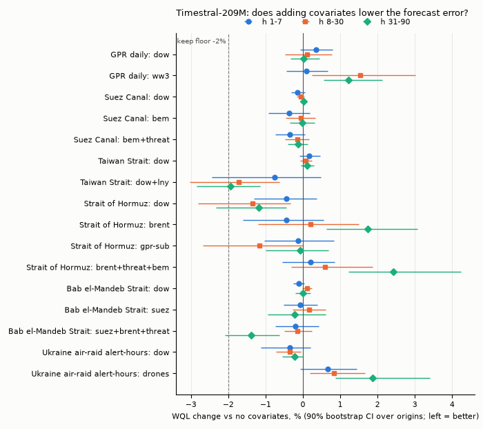
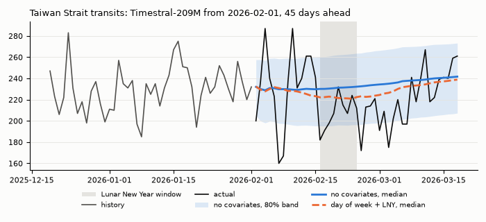

# Spike: do covariates make Timestral better on our series?

> **Correction, 2026-10-30.** The confidence intervals below treat overlapping 28-day origins as independent, so they are about 1.7 times too narrow. Every "drop" verdict stands, but the "significantly worse" labels and the Lunar New Year significance do not. Lunar New Year can be retested now on PortWatch's 8 holidays since 2019. See [Covariate per le previsioni aseri](reports/Covariate%20per%20le%20previsioni%20aseri.md).

Run on 2026-10-29. Prototype and rerun commands: `prototypes/timestral-covariates/` (see its README). It extends the baseline spike [spike-timestral-backtest.md](spike-timestral-backtest.md) with the same origins, horizons and metrics. Model background: [timestral-model.md](timestral-model.md). Data sources: [data-sources.md](data-sources.md).

## TL;DR

**No.** No covariate set made Timestral-209M meaningfully more accurate or better calibrated on any of the 6 series, so the daily job should stay univariate. All 16 sets fail the keep rule, which was fixed before any result was seen. The largest gain at the horizons the site would publish is −1.7% WQL (Taiwan Strait, with a Lunar New Year indicator). Four sets made at least one bucket significantly worse: World War III views for GPR, Brent and the 3-covariate set for Hormuz, and drones for the air-raid alerts.

ΔWQL is the relative change in WQL vs the no-covariate run on the same 52 origins, with a 90% paired-bootstrap CI over origins. Negative is better.

| Series | Best or most plausible set: ΔWQL h 1-7 / h 8-30 | Calibration (cov80) | Verdict |
|---|---|---|---|
| GPR daily | `dow`: +0.3% [−0.1, +0.8] / +0.1% [−0.5, +0.8]. World War III views make it worse: +1.5% [+0.2, +3.0] on 8-30 | unchanged (within ±0.01) | **No covariates** |
| Suez Canal | Bab el-Mandeb transits: −0.4% [−0.9, +0.2] / −0.1% [−0.5, +0.3] | 0.80 → 0.82 (slightly wider, not better) | **No covariates** |
| Taiwan Strait | day of week + Lunar New Year: −0.8% [−2.4, +0.5] / −1.7% [−3.0, −0.6]. Inside the 2026 holiday week, median MAE drops from 22.6 to 16.6 transits | unchanged | **No covariates** by the rule. The Lunar New Year indicator is the one idea worth revisiting: it needs no extra source, but it rests on a single holiday |
| Strait of Hormuz | Brent: −0.4% [−1.6, +0.6] / +0.2% [−1.2, +1.5]. Brent + GPR Threats + Bab el-Mandeb: +0.2% / +0.6%, and +2.4% [+1.2, +4.2] worse on 31-90. Day of week: −0.4% [−1.3, +0.4] / −1.3% [−2.8, −0.3] | unchanged (within ±0.01) | **No covariates** |
| Bab el-Mandeb Strait (new) | Suez + Brent + GPR Threats: −0.2% [−0.7, +0.4] / −0.1% [−0.5, +0.2] | unchanged | **No covariates** |
| Ukraine air-raid alert-hours (new) | Day of week: −0.4% [−1.1, +0.2] / −0.4% [−0.7, −0.1]. Drones claimed downed make it worse: +0.8% [+0.2, +1.7] on 8-30 | unchanged (within ±0.02) | **No covariates** |

- **Why there is no gain.** The model does use covariates. In a synthetic positive control where the covariate leads the target by 5 days, 209M cuts the error by 89% (see [Checks](#checks)). So the null result is about our covariates:
  - at daily resolution, the cross-series links are weak or same-day;
  - once each covariate is held back by its real publication lag, nothing is left that leads the target.
- **Calibration** does not change. Every cov80 change is within ±0.02 and every cov50 change within ±0.03, in either direction.
- **Timestral-28M agrees.** It shows the same pattern and no set passes. See [28M check](#28m-check).
- **Cost if any covariate were kept:**
  - The covariate path costs 3 to 4.5 times more inference per forecast. That is still seconds a day, so it is not the deciding factor.
  - The real cost: each cross-series covariate makes one series' forecast depend on another source being fetched, and being fresh, on the same day. See [Costs](#costs).
- **Leakage caveat:** covariates cannot fix the unknown training-data cutoff. See [Leakage caveat](#leakage-caveat).

## Setup

### Covariate API in the installed package

`timestral` 1.0.0 from git commit `a534bdb`, as installed in `prototypes/timestral-backtest/.venv/Lib/site-packages/timestral/`. The API is present and works; nothing had to be patched.

- `TimestralForecaster.forecast()` (`forecaster.py` line 161) takes `past_covariates` `(B, C_past, T)` and `known_covariates` `(B, C_known, T + prediction_length)` (docstring, lines 181 to 183), plus `categorical_past_covariates` and `categorical_known_covariates` (lines 184 to 190). Categorical codes are target-encoded per series against the forward-filled context.
- Shapes are enforced: past covariates "must cover exactly the context" (line 352), known covariates "the context plus the horizon" (line 364). NaN marks a missing covariate value and is masked.
- The default mirrored pass negates every covariate row along with the target (line 216).
- Known-future covariates need a layer schedule that can route the future to the target (`config.py` line 98); `forecast()` raises otherwise (line 218). Both 28M and 209M report `supports_known_covariates = True`.
- Past-only covariates get a blank, not a forecast, once decoding passes one block (line 408). One block is 32 patches of 32 steps (1,024 days) on both checkpoints, so a 90-day forecast is a single block and this never applies here.
- Any covariate switches the model to a different attention path that encodes context plus horizon (`model.py` line 191, `_predict_window` line 231). Known-future rows are scaled with non-causal whole-row statistics (`model.py` line 135).
- The package README (in `timestral-1.0.0.dist-info/METADATA`, sections "Covariates" at line 107 and "Categorical covariates" at line 122) documents the same API: covariates are conditioning rows, never forecast, and never read the targets.

### Series

Six targets: the 4 baseline series (exact same data vintage, read from the baseline spike's cache) plus 2 new ones.

| Target | Source, range | Notes |
|---|---|---|
| GPR daily (`GPRD`) | GPR `.dta`, 1985-01-01 to 2026-10-26 | baseline |
| Suez Canal, Taiwan Strait, Strait of Hormuz | PortWatch `n_total`, 2019-01-01 to 2026-10-25 | baseline |
| Bab el-Mandeb Strait | PortWatch `n_total`, 2019-01-01 to 2026-10-25 | new, fetched 2026-10-29 |
| Ukraine air-raid alert-hours | volunteer alerts CSV, 2022-02-25 to 2026-10-28 | new. Alert durations summed over the 25 regions per UTC day, events split at UTC midnight; 2026-10-29 dropped as a partial day |

Brent, drones claimed downed and Wikipedia "World War III" views are used only as covariates here; their own forecasts were not ablated, to keep the run inside the time budget.

### Candidate covariates

Covariates must be known when the forecast is made: past-only unless genuinely known in advance.

| Candidate | Kind | For | Rationale | Tested? |
|---|---|---|---|---|
| Day of week | known-future, categorical (target-encoded) | all 6 | GPR has a strong weekday cycle (newspaper volume); counts may have one. Free: no extra source | yes, every target |
| Lunar New Year holiday (eve to day +6) | known-future, 0/1 | Taiwan Strait | East Asian factory shutdowns lower traffic; the holiday week was at 0.84 to 0.97 of the prior 3 weeks in 6 of 8 years (0.91 in 2026) | yes |
| Western or Islamic holidays | known-future | GPR, chokepoints | no plausible mechanism on these series (GPR is a share of articles, not a count) | no |
| Bab el-Mandeb transits | past | Suez | same Red Sea corridor; northbound ships reach Suez a few days later. Detrended correlation with Suez peaks at only 0.18, at a 5 to 6 day lag | yes |
| Suez transits | past | Bab el-Mandeb | the same corridor, southbound | yes |
| Brent price | past | Hormuz, Bab el-Mandeb | oil prices react to Gulf and Red Sea disruptions, possibly before traffic does (Brent rose from 71 to 104 $/bbl between February and March 2026 as Hormuz collapsed) | yes |
| GPR Threats sub-index (`GPRD_THREAT`) | past | Hormuz, Suez, Bab el-Mandeb | threats can precede ships avoiding a route | yes |
| GPR Acts sub-index (`GPRD_ACT`) | past | Hormuz | realised attacks hit traffic directly | yes, with Threats |
| GPR sub-indexes | past | GPR itself | redundant: `GPRD` is built from the same article counts | no |
| Wikipedia "World War III" views | past | GPR | public attention spikes with the same events, possibly sooner | yes |
| Drones claimed downed per day | past | air-raid alert-hours | mass drone nights drive the alerts | yes |
| Air-raid alert-hours | past | drones | the reverse link | no (drones not a target here) |
| Other chokepoints | past | Taiwan Strait | no shared route or driver | no |

### Covariate sets (at most 3 covariates per set)

| Target | Sets besides `none` |
|---|---|
| GPR | `dow`; `ww3` (World War III views) |
| Suez Canal | `dow`; `bem` (Bab el-Mandeb); `bem+threat` (Bab el-Mandeb, GPR Threats) |
| Taiwan Strait | `dow`; `dow+lny` (day of week, Lunar New Year) |
| Strait of Hormuz | `dow`; `brent`; `gpr-sub` (GPR Threats and Acts); `brent+threat+bem` |
| Bab el-Mandeb Strait | `dow`; `suez`; `suez+brent+threat` |
| Air-raid alert-hours | `dow`; `drones` |

### No leakage from the future

- **Past covariates** are reindexed on the target's dates, so they cover exactly the context and never extend past the last context day.
- **Publication lag.** The daily job sees each source at a different staleness. For each pair, the last `max(0, covariate's worst-case lag − target's freshest lag)` context days of the covariate are set to NaN at every origin, so the backtest never uses a value the live job would not have yet.

  | Source | Worst-case lag used (days) | Basis |
  |---|---|---|
  | PortWatch | 4 | observed: data to 2026-10-25 on 2026-10-29 |
  | GPR | 7 (as a covariate), 0 (as a target, its freshest) | updated every Monday |
  | Brent (FRED) | 8 | weekly release batches |
  | Wikipedia views | 1 | complete up to yesterday |
  | Alerts | 1 | complete up to yesterday |
  | Drones (losses file) | 0 | the file carries today's report |

  Resulting masks: Brent for a PortWatch target 4 days, GPR Threats or Acts for a PortWatch target 3, World War III views for GPR 1, PortWatch for PortWatch 0, drones for alerts 0. Brent's weekends and holidays stay NaN (masked), not forward-filled.
- **Known-future covariates** are pure calendar functions of the date (day of week, Lunar New Year dates fixed years ahead), computed for the context plus the 90 forecast days.

### Backtest and metrics

Identical to the baseline spike: 52 weekly origins, one 90-step forecast per origin with the full history as context, default `forecast()` settings (mirrored pass on, non-negative clipping on), 4 torch threads. MASE (scale: mean |y_t − y_(t−7)| over the origin's context), WQL over 9 levels (0.1 to 0.9), cov80 (q0.1 to q0.9) and cov50 (q0.25 to q0.75), per horizon bucket 1-7, 8-30, 31-90, over origins with actuals for the whole bucket (N = 52, 48, 40).

**Paired comparison.** Each covariate run is compared with the no-covariate run of the same model on the same origins:

- ΔMASE and ΔWQL are relative changes in % (covariate run / no-covariate run − 1). Negative is better.
- Δcov80 and Δcov50 are absolute changes in coverage.
- 90% CI: paired bootstrap over origins, 2,000 resamples, recomputing both runs' metric on each resample.

**Keep rule (fixed before any result was seen).** Keep a covariate set for a series only if, on both the 1-7 and 8-30 buckets (the horizons the site would publish):

1. WQL improves by at least 2% and the 90% CI is entirely below 0,
2. MASE does not get worse (point estimate ≤ 0), and
3. cov80 stays within 0.70 to 0.90;

and no bucket gets significantly worse on WQL (CI entirely above 0). Otherwise drop it. The 2% floor is there because an extra data source is a daily failure point; a gain the public cannot see is not worth it.

### Checks

- `covariates.py` self-check (hand-made cases): alert-hours split at midnight (23:00 to 01:30 gives 2.0 h and 1.5 h); overlapping alerts in two regions count twice; a past covariate with a gap and a 2-day lag mask returns exactly `[1, 2, NaN, 4, NaN, NaN]`; a context date past the covariate's end returns NaN, never a later value; day-of-week and Lunar New Year rows over context plus horizon; the lag-mask table.
- `report.py` self-check: MASE, WQL (7.4/90) and coverage on the baseline spike's hand-computed quantile case; the paired bootstrap returns exactly −10% with a zero-width CI when one run's errors are 0.9 times the other's at every origin.
- **Reproduces the baseline.** The no-covariate runs equal the baseline spike's stored forecasts bit for bit (max abs difference 0 for all 4 baseline series with both 28M and 209M), and the recomputed naive, seasonal naive and 28-day mean MASE match the baseline tables. One headline number (Taiwan `dow+lny`, 8-30: ΔWQL −1.73%, ΔMASE −2.06%) was recomputed independently with plain numpy, and it matched.
- **Positive control** (`control.py`, synthetic series, 20 origins, h = 1 to 5): when the covariate carries the signal, the model uses it.

  | Case | 28M MAE without / with | 209M MAE without / with |
  |---|---|---|
  | y_t = x_(t−5) + noise, x passed as a past covariate | 4.95 / 1.57 (ratio 0.32) | 4.96 / 0.54 (ratio 0.11) |
  | y_t = 20 + 10·b_t + noise, b a random 0/1 indicator passed as known-future | 3.02 / 1.03 (ratio 0.34) | 3.03 / 1.05 (ratio 0.35) |

  The noise floors are about 0.4 and 0.8, so 209M extracts nearly all of a clean lead. A null result on real data therefore means the covariate carries little usable signal, not that the model ignores covariates.

## Results (Timestral-209M)

How to read the tables:

- Rows are covariate sets × horizon buckets. The `none` rows are the no-covariate run (identical to the baseline spike for the first 4 series).
- ΔMASE and ΔWQL are % changes vs `none`. Δcov80 and Δcov50 are absolute changes. All have a 90% paired-bootstrap CI over origins. Negative ΔMASE and ΔWQL are better.
- "Simple baselines" gives each baseline's MASE on the 1-7, 8-30 and 31-90 buckets.
- s/forecast is the median wall time per 90-day forecast, measured while 2 to 3 backtests shared the laptop: see [Costs](#costs).
- The bullet under each table applies the keep rule.

### GPR daily (GPRD)

Origins: context ends 2025-10-27 to 2026-10-19. Simple baselines, MASE per bucket: naive 1.79/2.29/3.00; snaive 1.61/2.08/2.71; mean28 1.65/1.96/2.49

| set | bucket | N | MASE | ΔMASE [90% CI] | WQL | ΔWQL [90% CI] | cov80 | Δcov80 [90% CI] | cov50 | Δcov50 [90% CI] | s/forecast |
|---|---|---|---|---|---|---|---|---|---|---|---|
| none | 1-7 | 52 | 1.220 | ref | 0.178 | ref | 0.77 | ref | 0.48 | ref | 4.96 |
| none | 8-30 | 48 | 1.627 | ref | 0.234 | ref | 0.76 | ref | 0.45 | ref | 4.96 |
| none | 31-90 | 40 | 1.964 | ref | 0.282 | ref | 0.69 | ref | 0.44 | ref | 4.96 |
| dow | 1-7 | 52 | 1.224 | +0.3% [-0.2, +0.8] | 0.178 | +0.3% [-0.1, +0.8] | 0.76 | -0.01 [-0.02, +0.01] | 0.46 | -0.02 [-0.04, +0.00] | 21.95 |
| dow | 8-30 | 48 | 1.627 | +0.0% [-0.7, +0.7] | 0.234 | +0.1% [-0.5, +0.8] | 0.76 | +0.00 [-0.01, +0.01] | 0.44 | -0.01 [-0.02, -0.00] | 21.95 |
| dow | 31-90 | 40 | 1.965 | +0.1% [-0.3, +0.6] | 0.282 | +0.0% [-0.3, +0.5] | 0.68 | -0.00 [-0.01, +0.00] | 0.44 | -0.00 [-0.01, +0.00] | 21.95 |
| ww3 | 1-7 | 52 | 1.222 | +0.1% [-0.4, +0.7] | 0.178 | +0.1% [-0.4, +0.7] | 0.77 | +0.01 [+0.00, +0.01] | 0.46 | -0.01 [-0.03, +0.00] | 22.31 |
| ww3 | 8-30 | 48 | 1.650 | +1.4% [+0.2, +2.8] | 0.237 | +1.5% [+0.2, +3.0] | 0.76 | -0.01 [-0.01, -0.00] | 0.44 | -0.01 [-0.03, -0.00] | 22.31 |
| ww3 | 31-90 | 40 | 1.985 | +1.1% [+0.5, +1.8] | 0.286 | +1.2% [+0.5, +2.1] | 0.67 | -0.01 [-0.02, -0.01] | 0.43 | -0.01 [-0.02, -0.01] | 22.31 |

- dow: **drop** (ΔWQL 1-7 +0.3% [-0.1, +0.8], 8-30 +0.1% [-0.5, +0.8], 31-90 +0.0% [-0.3, +0.5])
- ww3: **drop** (ΔWQL 1-7 +0.1% [-0.4, +0.7], 8-30 +1.5% [+0.2, +3.0], 31-90 +1.2% [+0.5, +2.1])

- Timestral already learns GPR's weekday cycle from 41 years of context: the explicit day-of-week row changes nothing (all |ΔWQL| ≤ 0.3%).
- World War III pageviews make the 8-30 and 31-90 buckets 1.2 to 1.5% worse, with CIs above zero. Attention spikes move with GPR on the same day, so a lagged copy brings no lead, only noise for the model to follow.

### Suez Canal

Origins: context ends 2025-10-26 to 2026-10-18. Simple baselines, MASE per bucket: naive 0.85/0.87/0.82; snaive 0.84/0.84/0.84; mean28 0.60/0.62/0.61

| set | bucket | N | MASE | ΔMASE [90% CI] | WQL | ΔWQL [90% CI] | cov80 | Δcov80 [90% CI] | cov50 | Δcov50 [90% CI] | s/forecast |
|---|---|---|---|---|---|---|---|---|---|---|---|
| none | 1-7 | 52 | 0.602 | ref | 0.095 | ref | 0.80 | ref | 0.52 | ref | 0.91 |
| none | 8-30 | 48 | 0.613 | ref | 0.097 | ref | 0.81 | ref | 0.53 | ref | 0.91 |
| none | 31-90 | 40 | 0.603 | ref | 0.096 | ref | 0.85 | ref | 0.56 | ref | 0.91 |
| dow | 1-7 | 52 | 0.601 | -0.2% [-0.4, +0.0] | 0.095 | -0.1% [-0.3, +0.1] | 0.80 | +0.00 [-0.01, +0.01] | 0.51 | -0.01 [-0.01, +0.00] | 3.34 |
| dow | 8-30 | 48 | 0.613 | -0.0% [-0.1, +0.1] | 0.097 | -0.1% [-0.2, +0.0] | 0.81 | +0.00 [+0.00, +0.01] | 0.52 | -0.00 [-0.01, +0.00] | 3.34 |
| dow | 31-90 | 40 | 0.603 | +0.1% [+0.0, +0.2] | 0.096 | +0.0% [-0.1, +0.1] | 0.85 | -0.00 [-0.01, +0.00] | 0.56 | -0.01 [-0.01, -0.00] | 3.34 |
| bem | 1-7 | 52 | 0.599 | -0.5% [-1.3, +0.2] | 0.094 | -0.4% [-0.9, +0.2] | 0.82 | +0.02 [+0.00, +0.03] | 0.52 | +0.01 [-0.01, +0.02] | 3.78 |
| bem | 8-30 | 48 | 0.611 | -0.2% [-0.7, +0.2] | 0.097 | -0.1% [-0.5, +0.3] | 0.82 | +0.01 [+0.00, +0.02] | 0.53 | +0.00 [-0.01, +0.02] | 3.78 |
| bem | 31-90 | 40 | 0.603 | -0.0% [-0.3, +0.3] | 0.096 | -0.0% [-0.4, +0.3] | 0.85 | -0.00 [-0.01, +0.00] | 0.55 | -0.02 [-0.03, -0.01] | 3.78 |
| bem+threat | 1-7 | 52 | 0.600 | -0.4% [-0.9, +0.1] | 0.094 | -0.4% [-0.7, +0.1] | 0.82 | +0.02 [+0.00, +0.03] | 0.52 | +0.01 [-0.01, +0.02] | 5.81 |
| bem+threat | 8-30 | 48 | 0.611 | -0.2% [-0.6, +0.2] | 0.097 | -0.1% [-0.5, +0.2] | 0.82 | +0.01 [+0.01, +0.02] | 0.53 | +0.01 [-0.00, +0.02] | 5.81 |
| bem+threat | 31-90 | 40 | 0.602 | -0.2% [-0.4, +0.0] | 0.096 | -0.1% [-0.4, +0.1] | 0.86 | +0.00 [+0.00, +0.01] | 0.58 | +0.02 [+0.01, +0.02] | 5.81 |

- dow: **drop** (ΔWQL 1-7 -0.1% [-0.3, +0.1], 8-30 -0.1% [-0.2, +0.0], 31-90 +0.0% [-0.1, +0.1])
- bem: **drop** (ΔWQL 1-7 -0.4% [-0.9, +0.2], 8-30 -0.1% [-0.5, +0.3], 31-90 -0.0% [-0.4, +0.3])
- bem+threat: **drop** (ΔWQL 1-7 -0.4% [-0.7, +0.1], 8-30 -0.1% [-0.5, +0.2], 31-90 -0.1% [-0.4, +0.1])

- Every effect is 0.5% or less. The Bab el-Mandeb lead is physically real but statistically weak: the detrended correlation between Suez and lagged Bab el-Mandeb transits peaks at 0.18, at a 5 to 6 day lag.
- Bab el-Mandeb widens the band slightly (cov80 0.80 → 0.82 on 1-7). That is not a calibration gain, since 0.80 was already on target.

### Taiwan Strait

Origins: context ends 2025-10-26 to 2026-10-18. Simple baselines, MASE per bucket: naive 1.04/1.01/1.04; snaive 1.18/1.15/1.20; mean28 0.79/0.77/0.83

| set | bucket | N | MASE | ΔMASE [90% CI] | WQL | ΔWQL [90% CI] | cov80 | Δcov80 [90% CI] | cov50 | Δcov50 [90% CI] | s/forecast |
|---|---|---|---|---|---|---|---|---|---|---|---|
| none | 1-7 | 52 | 0.791 | ref | 0.091 | ref | 0.81 | ref | 0.54 | ref | 1.40 |
| none | 8-30 | 48 | 0.760 | ref | 0.086 | ref | 0.84 | ref | 0.54 | ref | 1.40 |
| none | 31-90 | 40 | 0.756 | ref | 0.085 | ref | 0.83 | ref | 0.54 | ref | 1.40 |
| dow | 1-7 | 52 | 0.792 | +0.0% [-0.2, +0.4] | 0.091 | +0.2% [-0.1, +0.5] | 0.81 | +0.01 [-0.00, +0.01] | 0.53 | -0.01 [-0.02, +0.00] | 4.31 |
| dow | 8-30 | 48 | 0.760 | -0.0% [-0.2, +0.2] | 0.086 | +0.1% [-0.1, +0.2] | 0.84 | +0.01 [+0.00, +0.01] | 0.54 | -0.00 [-0.01, +0.00] | 4.31 |
| dow | 31-90 | 40 | 0.757 | +0.1% [-0.1, +0.3] | 0.085 | +0.1% [-0.1, +0.3] | 0.83 | +0.01 [+0.00, +0.01] | 0.54 | +0.00 [-0.00, +0.00] | 4.31 |
| dow+lny | 1-7 | 52 | 0.783 | -1.0% [-2.8, +0.4] | 0.091 | -0.8% [-2.4, +0.5] | 0.81 | +0.00 [-0.01, +0.01] | 0.53 | -0.01 [-0.03, +0.01] | 6.79 |
| dow+lny | 8-30 | 48 | 0.744 | -2.1% [-3.7, -0.7] | 0.085 | -1.7% [-3.0, -0.6] | 0.84 | +0.00 [-0.01, +0.01] | 0.55 | +0.01 [-0.01, +0.02] | 6.79 |
| dow+lny | 31-90 | 40 | 0.736 | -2.6% [-3.8, -1.5] | 0.083 | -1.9% [-2.8, -1.1] | 0.84 | +0.01 [+0.00, +0.01] | 0.56 | +0.01 [+0.00, +0.03] | 6.79 |

- dow: **drop** (ΔWQL 1-7 +0.2% [-0.1, +0.5], 8-30 +0.1% [-0.1, +0.2], 31-90 +0.1% [-0.1, +0.3])
- dow+lny: **drop** (ΔWQL 1-7 -0.8% [-2.4, +0.5], 8-30 -1.7% [-3.0, -0.6], 31-90 -1.9% [-2.8, -1.1])

- Day of week alone: nothing.
- The Lunar New Year indicator is the only covariate with a visible, interpretable effect:
  - 14 origins forecast at least one day of the 2026 holiday window (2026-02-16 to 2026-02-23), 103 (origin, h) points in all.
  - On those points the median MAE falls from 22.6 to 16.6 transits (−27%) with 209M, and from 21.3 to 15.4 with 28M.
  - Spread over every origin, that dilutes to −1.7% WQL on 8-30, below the 2% floor, and the 1-7 bucket is not significant.
  - The backtest year holds exactly one holiday, so this is one event, not a measured average.

The chart shows the forecast from the origin whose context ends 2026-02-01. With the indicator, the median dips about 8 transits during the holiday week. The actual dip is larger and noisier.

### Strait of Hormuz

Origins: context ends 2025-10-26 to 2026-10-18. Simple baselines, MASE per bucket: naive 0.57/0.92/1.52; snaive 0.68/1.07/1.75; mean28 0.83/1.14/1.80

| set | bucket | N | MASE | ΔMASE [90% CI] | WQL | ΔWQL [90% CI] | cov80 | Δcov80 [90% CI] | cov50 | Δcov50 [90% CI] | s/forecast |
|---|---|---|---|---|---|---|---|---|---|---|---|
| none | 1-7 | 52 | 0.542 | ref | 0.233 | ref | 0.77 | ref | 0.44 | ref | 1.46 |
| none | 8-30 | 48 | 0.875 | ref | 0.431 | ref | 0.72 | ref | 0.46 | ref | 1.46 |
| none | 31-90 | 40 | 1.787 | ref | 1.071 | ref | 0.67 | ref | 0.43 | ref | 1.46 |
| dow | 1-7 | 52 | 0.542 | -0.1% [-0.8, +0.9] | 0.232 | -0.4% [-1.3, +0.4] | 0.76 | -0.01 [-0.02, -0.00] | 0.44 | -0.01 [-0.02, +0.01] | 4.19 |
| dow | 8-30 | 48 | 0.861 | -1.6% [-2.8, -0.7] | 0.426 | -1.3% [-2.8, -0.3] | 0.72 | -0.00 [-0.01, +0.00] | 0.46 | +0.00 [-0.01, +0.01] | 4.19 |
| dow | 31-90 | 40 | 1.759 | -1.6% [-3.5, -0.4] | 1.059 | -1.2% [-2.3, -0.4] | 0.66 | -0.00 [-0.01, +0.00] | 0.43 | -0.01 [-0.02, +0.01] | 4.19 |
| brent | 1-7 | 52 | 0.538 | -0.7% [-2.1, +0.3] | 0.232 | -0.4% [-1.6, +0.6] | 0.77 | +0.00 [-0.01, +0.01] | 0.45 | +0.01 [-0.00, +0.03] | 4.48 |
| brent | 8-30 | 48 | 0.879 | +0.4% [-1.1, +1.8] | 0.432 | +0.2% [-1.2, +1.5] | 0.73 | +0.00 [-0.00, +0.01] | 0.47 | +0.01 [-0.01, +0.02] | 4.48 |
| brent | 31-90 | 40 | 1.798 | +0.6% [-1.1, +2.1] | 1.090 | +1.7% [+0.6, +3.1] | 0.67 | +0.00 [-0.01, +0.01] | 0.43 | -0.00 [-0.02, +0.01] | 4.48 |
| gpr-sub | 1-7 | 52 | 0.545 | +0.6% [-0.3, +1.8] | 0.232 | -0.1% [-1.0, +0.8] | 0.75 | -0.01 [-0.03, +0.00] | 0.43 | -0.01 [-0.04, +0.01] | 6.28 |
| gpr-sub | 8-30 | 48 | 0.872 | -0.4% [-1.5, +0.4] | 0.426 | -1.2% [-2.7, -0.0] | 0.71 | -0.01 [-0.02, -0.00] | 0.45 | -0.02 [-0.04, -0.00] | 6.28 |
| gpr-sub | 31-90 | 40 | 1.798 | +0.6% [-0.0, +1.4] | 1.071 | -0.1% [-1.0, +0.7] | 0.66 | -0.01 [-0.02, +0.00] | 0.41 | -0.03 [-0.05, -0.01] | 6.28 |
| brent+threat+bem | 1-7 | 52 | 0.541 | -0.1% [-1.1, +0.6] | 0.233 | +0.2% [-0.6, +0.8] | 0.76 | -0.01 [-0.03, +0.01] | 0.43 | -0.01 [-0.03, +0.01] | 7.94 |
| brent+threat+bem | 8-30 | 48 | 0.875 | -0.1% [-0.9, +1.1] | 0.434 | +0.6% [-0.3, +1.9] | 0.72 | -0.00 [-0.01, +0.00] | 0.45 | -0.01 [-0.03, +0.01] | 7.94 |
| brent+threat+bem | 31-90 | 40 | 1.817 | +1.7% [+0.6, +3.2] | 1.097 | +2.4% [+1.2, +4.2] | 0.66 | -0.00 [-0.01, +0.01] | 0.41 | -0.02 [-0.04, -0.00] | 7.94 |

- dow: **drop** (ΔWQL 1-7 -0.4% [-1.3, +0.4], 8-30 -1.3% [-2.8, -0.3], 31-90 -1.2% [-2.3, -0.4])
- brent: **drop** (ΔWQL 1-7 -0.4% [-1.6, +0.6], 8-30 +0.2% [-1.2, +1.5], 31-90 +1.7% [+0.6, +3.1])
- gpr-sub: **drop** (ΔWQL 1-7 -0.1% [-1.0, +0.8], 8-30 -1.2% [-2.7, -0.0], 31-90 -0.1% [-1.0, +0.7])
- brent+threat+bem: **drop** (ΔWQL 1-7 +0.2% [-0.6, +0.8], 8-30 +0.6% [-0.3, +1.9], 31-90 +2.4% [+1.2, +4.2])

- None of the plausible drivers helps on the publishable buckets.
  - Brent rose from 71 to 104 $/bbl (February to March monthly means) as transits collapsed from 78 to 3 a day. But it moved in the same weeks, and with the 4-day publication mask a past-only price row cannot lead a same-week shock.
  - On the 31-90 bucket, Brent alone is 1.7% worse, and Brent with GPR Threats and Bab el-Mandeb 2.4% worse, both with CIs above zero.
- Day of week gives a small gain that both models agree on: 209M −1.3% [−2.8, −0.3] on 8-30, 28M −0.9% [−1.6, −0.4]. That is below the floor.
  - The mechanism is unclear. A guess: the target-encoded weekday row carries multi-year weekday means and acts as a pull toward the old level.

### Bab el-Mandeb Strait

Origins: context ends 2025-10-26 to 2026-10-18. Simple baselines, MASE per bucket: naive 0.84/0.87/0.93; snaive 0.90/0.92/0.96; mean28 0.65/0.67/0.76

| set | bucket | N | MASE | ΔMASE [90% CI] | WQL | ΔWQL [90% CI] | cov80 | Δcov80 [90% CI] | cov50 | Δcov50 [90% CI] | s/forecast |
|---|---|---|---|---|---|---|---|---|---|---|---|
| none | 1-7 | 52 | 0.649 | ref | 0.122 | ref | 0.80 | ref | 0.50 | ref | 1.28 |
| none | 8-30 | 48 | 0.681 | ref | 0.128 | ref | 0.80 | ref | 0.49 | ref | 1.28 |
| none | 31-90 | 40 | 0.772 | ref | 0.145 | ref | 0.77 | ref | 0.45 | ref | 1.28 |
| dow | 1-7 | 52 | 0.648 | -0.1% [-0.3, +0.0] | 0.122 | -0.1% [-0.3, +0.0] | 0.80 | +0.00 [+0.00, +0.01] | 0.50 | +0.00 [-0.01, +0.01] | 3.98 |
| dow | 8-30 | 48 | 0.680 | -0.0% [-0.1, +0.1] | 0.128 | +0.1% [-0.0, +0.2] | 0.80 | +0.00 [+0.00, +0.01] | 0.50 | +0.01 [+0.00, +0.02] | 3.98 |
| dow | 31-90 | 40 | 0.771 | -0.1% [-0.2, +0.1] | 0.145 | -0.0% [-0.2, +0.2] | 0.77 | +0.01 [+0.00, +0.01] | 0.45 | +0.00 [+0.00, +0.01] | 3.98 |
| suez | 1-7 | 52 | 0.648 | -0.1% [-0.6, +0.5] | 0.122 | -0.1% [-0.5, +0.4] | 0.80 | -0.00 [-0.01, +0.01] | 0.49 | -0.01 [-0.02, +0.01] | 3.89 |
| suez | 8-30 | 48 | 0.682 | +0.2% [-0.2, +0.6] | 0.128 | +0.2% [-0.3, +0.6] | 0.78 | -0.02 [-0.03, -0.01] | 0.49 | +0.00 [-0.01, +0.01] | 3.89 |
| suez | 31-90 | 40 | 0.770 | -0.2% [-0.9, +0.5] | 0.144 | -0.2% [-0.9, +0.6] | 0.75 | -0.01 [-0.02, -0.01] | 0.43 | -0.01 [-0.02, -0.00] | 3.89 |
| suez+brent+threat | 1-7 | 52 | 0.647 | -0.2% [-0.7, +0.3] | 0.122 | -0.2% [-0.7, +0.4] | 0.79 | -0.01 [-0.01, +0.00] | 0.49 | -0.01 [-0.02, +0.01] | 6.75 |
| suez+brent+threat | 8-30 | 48 | 0.679 | -0.2% [-0.6, +0.2] | 0.128 | -0.1% [-0.5, +0.2] | 0.80 | -0.00 [-0.01, +0.00] | 0.50 | +0.01 [+0.00, +0.02] | 6.75 |
| suez+brent+threat | 31-90 | 40 | 0.762 | -1.2% [-1.9, -0.5] | 0.143 | -1.4% [-2.1, -0.6] | 0.77 | +0.00 [-0.00, +0.01] | 0.45 | +0.01 [+0.00, +0.01] | 6.75 |

- dow: **drop** (ΔWQL 1-7 -0.1% [-0.3, +0.0], 8-30 +0.1% [-0.0, +0.2], 31-90 -0.0% [-0.2, +0.2])
- suez: **drop** (ΔWQL 1-7 -0.1% [-0.5, +0.4], 8-30 +0.2% [-0.3, +0.6], 31-90 -0.2% [-0.9, +0.6])
- suez+brent+threat: **drop** (ΔWQL 1-7 -0.2% [-0.7, +0.4], 8-30 -0.1% [-0.5, +0.2], 31-90 -1.4% [-2.1, -0.6])

- New series. Like Suez, Timestral ties the 28-day mean on point accuracy (MASE 0.65/0.68/0.77 vs 0.65/0.67/0.76) with well-calibrated bands (cov80 0.80, 0.80, 0.77).
- Suez transits add nothing. The 3-covariate set helps only on 31-90 (−1.4%).

### Ukraine air-raid alert-hours

Origins: context ends 2025-10-29 to 2026-10-21. Simple baselines, MASE per bucket: naive 0.70/0.74/0.77; snaive 0.80/0.77/0.80; mean28 0.57/0.56/0.59

| set | bucket | N | MASE | ΔMASE [90% CI] | WQL | ΔWQL [90% CI] | cov80 | Δcov80 [90% CI] | cov50 | Δcov50 [90% CI] | s/forecast |
|---|---|---|---|---|---|---|---|---|---|---|---|
| none | 1-7 | 52 | 0.552 | ref | 0.169 | ref | 0.82 | ref | 0.54 | ref | 0.54 |
| none | 8-30 | 48 | 0.551 | ref | 0.167 | ref | 0.85 | ref | 0.56 | ref | 0.54 |
| none | 31-90 | 40 | 0.552 | ref | 0.169 | ref | 0.88 | ref | 0.59 | ref | 0.54 |
| dow | 1-7 | 52 | 0.550 | -0.3% [-1.3, +0.4] | 0.168 | -0.4% [-1.1, +0.2] | 0.81 | -0.01 [-0.02, -0.00] | 0.53 | -0.01 [-0.02, +0.01] | 1.35 |
| dow | 8-30 | 48 | 0.549 | -0.3% [-0.6, +0.0] | 0.167 | -0.4% [-0.7, -0.1] | 0.84 | -0.01 [-0.01, -0.00] | 0.55 | -0.01 [-0.01, -0.00] | 1.35 |
| dow | 31-90 | 40 | 0.552 | -0.0% [-0.2, +0.2] | 0.169 | -0.2% [-0.5, -0.0] | 0.87 | -0.01 [-0.01, -0.01] | 0.58 | -0.01 [-0.02, -0.01] | 1.35 |
| drones | 1-7 | 52 | 0.556 | +0.7% [-0.1, +1.6] | 0.170 | +0.7% [-0.1, +1.4] | 0.81 | -0.01 [-0.02, +0.00] | 0.54 | +0.00 [-0.01, +0.01] | 1.32 |
| drones | 8-30 | 48 | 0.555 | +0.7% [+0.1, +1.2] | 0.169 | +0.8% [+0.2, +1.7] | 0.84 | -0.02 [-0.02, -0.01] | 0.54 | -0.01 [-0.02, -0.00] | 1.32 |
| drones | 31-90 | 40 | 0.559 | +1.3% [+0.8, +1.8] | 0.172 | +1.9% [+0.9, +3.4] | 0.87 | -0.01 [-0.02, -0.01] | 0.58 | -0.02 [-0.03, -0.01] | 1.32 |

- dow: **drop** (ΔWQL 1-7 -0.4% [-1.1, +0.2], 8-30 -0.4% [-0.7, -0.1], 31-90 -0.2% [-0.5, -0.0])
- drones: **drop** (ΔWQL 1-7 +0.7% [-0.1, +1.4], 8-30 +0.8% [+0.2, +1.7], 31-90 +1.9% [+0.9, +3.4])

- New series. Timestral beats the 28-day mean by 2 to 6% on MASE (0.55 vs 0.56 to 0.59) and naive by 21 to 28%. Its bands are a little wide (cov80 0.82 to 0.88).
- Drones claimed downed make every bucket worse, by 0.7 to 1.9%.
  - The count comes from the next morning's report and is a noisy proxy for the same night's alerts. Past-only, it carries no lead.
- Day of week gives −0.4% at best.

## 28M check

ΔWQL for Timestral-28M, h 1-7 / 8-30 / 31-90, same origins, rule and bootstrap:

| Series | Set | h 1-7 | h 8-30 | h 31-90 | Verdict |
|---|---|---|---|---|---|
| GPR daily (GPRD) | dow | +0.4% [-0.2, +1.1] | +1.0% [+0.3, +1.7] | +2.1% [+1.6, +2.5] | drop |
| GPR daily (GPRD) | ww3 | +0.6% [-0.4, +1.6] | +0.7% [-0.3, +2.1] | +0.9% [+0.5, +1.3] | drop |
| Suez Canal | dow | +0.0% [-0.2, +0.3] | -0.0% [-0.2, +0.2] | -0.3% [-0.5, -0.1] | drop |
| Suez Canal | bem | -0.3% [-0.6, +0.1] | -0.3% [-0.7, +0.1] | -0.9% [-1.2, -0.6] | drop |
| Suez Canal | bem+threat | -0.2% [-0.5, +0.1] | -0.2% [-0.4, +0.1] | -0.6% [-0.8, -0.3] | drop |
| Taiwan Strait | dow | +0.1% [-0.2, +0.4] | -0.0% [-0.2, +0.1] | +0.1% [-0.0, +0.2] | drop |
| Taiwan Strait | dow+lny | -0.9% [-2.4, +0.1] | -1.8% [-2.9, -0.8] | -1.6% [-2.4, -0.9] | drop |
| Strait of Hormuz | dow | -1.0% [-1.6, -0.3] | -0.9% [-1.6, -0.4] | -1.4% [-2.0, -0.9] | drop |
| Strait of Hormuz | brent | -0.8% [-2.0, +0.1] | -1.5% [-3.5, +0.2] | -1.5% [-3.4, +0.1] | drop |
| Strait of Hormuz | gpr-sub | -0.8% [-1.7, +0.3] | -2.3% [-3.9, -1.1] | -1.2% [-2.0, -0.3] | drop |
| Strait of Hormuz | brent+threat+bem | -0.4% [-1.2, +0.4] | -1.5% [-3.1, +0.4] | -0.9% [-2.2, +0.3] | drop |
| Bab el-Mandeb Strait | dow | +0.0% [-0.3, +0.3] | -0.2% [-0.5, +0.1] | -1.6% [-2.1, -0.9] | drop |
| Bab el-Mandeb Strait | suez | -0.1% [-0.4, +0.3] | -0.0% [-0.2, +0.1] | +0.1% [-0.3, +0.5] | drop |
| Bab el-Mandeb Strait | suez+brent+threat | -0.1% [-0.5, +0.4] | +0.6% [+0.0, +1.3] | -0.5% [-1.0, +0.0] | drop |
| Ukraine air-raid alert-hours | dow | +0.6% [-0.0, +1.5] | +0.2% [+0.0, +0.5] | -0.3% [-0.5, -0.2] | drop |
| Ukraine air-raid alert-hours | drones | +1.5% [+0.0, +3.7] | +1.5% [+0.3, +3.3] | +2.0% [+0.4, +4.6] | drop |

The pattern matches 209M: nothing passes. The only gains on 8-30 with CIs below zero are Taiwan with the Lunar New Year indicator (−1.8%), Hormuz with day of week (−0.9%) and Hormuz with GPR Threats and Acts (−2.3%, whose 1-7 bucket is not significant). Hormuz is the series where 28M was weakest in the baseline spike, so it has the most room to gain. Day of week makes GPR worse for 28M on 8-30 and 31-90.

## Verdicts

Drop covariates for all 6 series. Keep the univariate forecast from the baseline spike.

- **GPR, Suez, Bab el-Mandeb, air-raid alert-hours:** drop. No effect, or a significantly worse one.
- **Strait of Hormuz:** drop. The regime-shift case, where external drivers looked most plausible, gains nothing from Brent or GPR, because neither leads the transits once publication lags are respected.
- **Taiwan Strait:** drop by the rule. If the site later wants a better forecast around Lunar New Year, the indicator is the one cheap idea to retest: it is a calendar list, not a data source. Retest it after the 2027 holiday (2027-02-06), so the result rests on more than one event.
- Day of week is free but not worth it. It adds 3x inference and code for gains of at most 1.3% (Hormuz, 8-30).

## Costs

What each covariate would add to the daily job, had it passed:

| Covariate | Extra source for the daily job | Failure points | Freshness |
|---|---|---|---|
| Day of week | none | none | always known |
| Lunar New Year | a hard-coded date list | needs one new date a year | known years ahead |
| Bab el-Mandeb or Suez transits | no new service (PortWatch is fetched anyway), one more query a day | PortWatch returns errors inside HTTP 200 and needs retries; a failed query now blocks two series | same lag as the target, so no mask |
| GPR Threats, Acts | none (same GPR file) | none beyond GPR itself | weekly: the last 3 days are always masked for a PortWatch target |
| Brent | FRED CSV, a new source | one more fetch | weekly batches, up to 8 days stale: 4 days masked |
| World War III views | Wikimedia API (needs a User-Agent) | one more fetch | 1 day |
| Drones claimed downed | GitHub JSON | one more fetch | same day |

- **Coupling** is the main cost. With a cross-series covariate, target X's forecast depends on source Y's fetch. When Y is late or down, the job must either:
  - skip X's forecast, or
  - pass NaN for the missing days (the model accepts it) and publish a forecast made under conditions the backtest never scored.
- **Inference:** any covariate switches the model to the covariate attention path.
  - Measured without contention (28M, Suez): 0.12 s per forecast with no covariates, 0.37 s with one covariate, 0.53 s with two. That is 3.1x and 4.4x.
  - With 209M under contention: GPR 5.0 s to 22 s, the PortWatch series 0.9 to 1.5 s to 3.3 to 7.9 s.
  - A daily 209M run of 6 series would go from about 7 s to about 20 to 30 s of inference (the baseline spike's uncontended timings times 3 to 4.5). That is negligible next to the 2 to 3 minute setup measured in the baseline spike.

## Leakage caveat

**Covariates cannot fix the unknown training-data cutoff.**

- As in the baseline spike, Timestral's training-data cutoff is not published: issue mistralai/timestral#3 was unanswered on 2026-10-29.
- All targets and covariates here are public, so the October 2025 to October 2026 backtest window may overlap the training data.
- The bias can run either way:
  - A model that has memorised the Hormuz collapse needs no Brent to forecast it, which would hide a real covariate gain.
  - A model that has memorised co-movement could make a covariate look more useful than it will be live.
- No recent-origin slice was computed for the covariate runs: 7 origins cannot resolve effects of 1 to 2%.
- The live track record remains the first clean test, for covariates as for the base model.

## Limits

- **Small, untuned covariate sets** (on purpose, so the rule could be fixed in advance):
  - Covariates were passed raw. The model has to find any lag itself, with no lagged or differenced versions and no log of the pageviews.
  - Day of week was tested only as a target-encoded categorical, not as numeric or one-hot rows.
- **Daily resolution.** Links that act within hours, such as drone waves and alerts, are invisible to a past-only daily covariate.
- **One Lunar New Year** in the backtest window.
- **Approximate publication lags.** The masks use worst-case lags observed on 2026-10-29. PortWatch's lag is assumed constant at 4 days, and the backtest uses today's data vintage, not the values known at each origin (GPR and Brent get revised).
- **Optimistic CIs.** The bootstrap ignores the overlap between neighbouring origins' target windows, as in the baseline spike. That makes "significant" easier to reach, which strengthens the null result.
- **Scope.** Brent, drones and World War III views were used only as covariates: their own forecasts were not ablated. Covariates for GPR's sub-indexes, and air-raid hours as a covariate for drones, were not tested.
- **Timings** come from a laptop running 2 to 3 backtests at once, so absolute times are inflated: Suez with no covariates took 0.91 s per forecast here vs 0.69 s in the baseline spike. The ratios are what matter.
