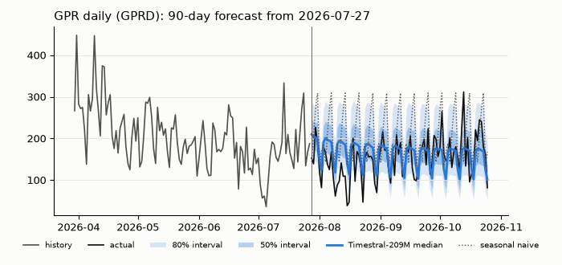
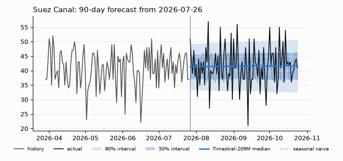
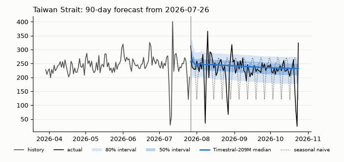
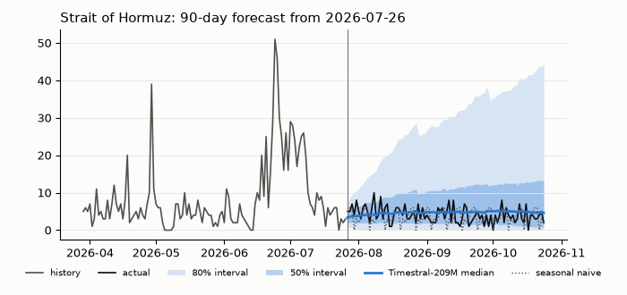

# Spike: how far ahead does Timestral forecast our series usefully?

> **Correction, 2026-10-30.** Read the GPR scores as an upper bound. Inputs and actuals came from a revised vintage (GPR revises its last 30 days by a median of 7.6 to 9.2%), and the bootstrap ignored overlapping origins. See [Best practice previsioni probabilistiche](reports/Best%20practice%20previsioni%20probabilistiche.md) and issue #145 for the real-time rebuild.
>
> **Measured, 2026-10-31: the GPR scores below are an upper bound.** Rebuilt in real time from the authors' 295 archived vintages, on 232 weekly origins, the production model's WIS is 10.6% higher at 1-7 days [7.2%, 14.0%] and 6.5% higher at 8-28 days [3.5%, 9.3%] than on the latest vintage, and its 80% band holds about 2 points fewer days. Timestral still beats every baseline in real time. See [gpr-realtime-backtest.md](gpr-realtime-backtest.md).

Run on 2026-10-29. Prototype and rerun commands: `prototypes/timestral-backtest/` (see its README). Model background: [timestral-model.md](timestral-model.md). Data sources: [data-sources.md](data-sources.md).

## TL;DR

The verdict rule from the brief: the longest horizon where Timestral beats seasonal naive on MASE **and** its 80% interval covers 70 to 90% of actuals. Because the public track record has to beat "a naive method" honestly, the last column also checks the last-value naive and a flat 28-day mean.

| Series | Brief's rule, Timestral-209M | Horizon I would publish | Why |
|---|---|---|---|
| GPR daily (`GPRD`) | Passes at h = 7, 14, 30, 60. Fails at h = 1 and h = 90, and on the 31-90 bucket, only on coverage (0.67, 0.68, 0.69) | **30 days** (60 is borderline) | Beats the best baseline at every horizon: by 6 to 25% at single horizons and 17 to 24% on the buckets. The 80% band is a little too narrow, most of all at h = 1 |
| Suez Canal | Passes h = 1 to 30 and all three buckets, including 31-90. Fails at single h = 60 and 90 only because the band is too wide (coverage 0.95, 0.93) | **30 days**, with no claim of point skill | Point accuracy matches a flat 28-day mean within 0.01 MASE (1-7 bucket: 0.60 vs 0.60). Its edge over seasonal naive comes from that baseline copying last week's noise. The added value is a well-calibrated band |
| Taiwan Strait | Passes at every horizon up to 90 | **30 days** (90 is defensible) | Clearly beats naive and seasonal naive. It ties the 28-day mean up to 30 days and is about 8% better over 31-90 |
| Strait of Hormuz (stress case) | 209M passes h = 1 to 60 and fails at 90 and on 31-90. 28M fails at 14 and 60 | **7 to 14 days** | The last-value naive ties 209M at h = 30 (MASE 0.94 vs 0.94) and beats it at h = 60 (1.43 vs 1.60) |

- **28M vs 209M:** on GPR, Suez and Taiwan they are interchangeable (bucket MASE and cov80 within 0.02; single horizons differ by up to 0.05). On Hormuz, 209M is 10 to 20% better from h = 14 on (8-30 bucket: 0.88 vs 0.99; 31-90: 1.79 vs 2.16). The 28M is 5 to 6 times faster, but 209M costs only about 7 s of CPU a day, so **use 209M in CI**. Use 28M only if the weights cache size (111 MB vs 837 MB) matters more than accuracy on regime shifts.
- **Runtime (4 torch threads, laptop CPU):**
  - 209M takes 0.69 s per forecast on a 2,855-day context and 3.35 s on the 15,274-day GPR context. 28M takes 0.12 s and 0.53 s.
  - One daily run of 4 series is about 5.5 s of inference plus 1.6 s of model load.
  - Peak RAM is 1.8 GiB (209M) and 0.45 GiB (28M).
  - Setup, not inference, dominates CI cost. See [Runtime and CI cost](#runtime-and-ci-cost).
- **Leakage caveat:** Timestral's training-data cutoff is unknown, so the backtest may flatter the model. See [Leakage caveat](#leakage-caveat).

## Setup

**Data** (fetched 2026-10-29 by `fetch.py`, no gaps in any series):

- GPR: `data_gpr_daily_recent.dta` read with `pandas.read_stata`. The column used is **`GPRD`**, the daily total index. The other columns are `DAY`, `N10D`, `GPRD_ACT`, `GPRD_THREAT`, `date`, `GPRD_MA30`, `GPRD_MA7` and `event`. The file has 15,274 daily rows, from 1985-01-01 to 2026-10-26.
- IMF PortWatch: the `Daily_Chokepoints_Data` FeatureServer, field `n_total`. The exact `portname` values are `Suez Canal`, `Taiwan Strait` and `Strait of Hormuz`. Each has 2,855 daily rows, from 2019-01-01 to 2026-10-25.

**Models:**

- `mistralai/Timestral-28M` at HF revision `49b26409ac87b5935539a5d8ffe7f397b720db47`.
- `mistralai/Timestral-209M` at HF revision `9874d252ab0aae16f7f7c999f98f98d6ad7d8365`.
- Software: package `timestral` 1.0.0 from git commit `a534bdb`, torch 2.15.0+cpu, Python 3.12.
- Default `forecast()` settings: mirrored second pass (`symmetric_averaging=True`), `clip_nonnegative=True`, no covariates.
- Both checkpoints have `context_length` 32,768, so the full history is always the context.

**Backtest:**

- **Origins:** 52, one every 7 days. Origin k (k = 1 to 52) uses all data up to the last date minus 7k days as context. Context ends run from 2025-10-26 to 2026-10-18 for PortWatch, and from 2025-10-27 to 2026-10-19 for GPR.
- **Forecasts:** one 90-step forecast per origin.
- **Scoring:** steps past the last data point are not scored, so N falls from 52 (h ≤ 7) to 40 (h = 90). Bucket rows (1-7, 8-30, 31-90) use only origins that have actuals for the whole bucket.
- **Baselines:**
  - naive: last value, held flat.
  - seasonal naive ("snaive"): the last 7 days, repeated.
  - mean28 (a reference I added, not part of the verdict rule): the mean of the last 28 days, held flat.

**Metrics** (`report.py`):

- **MASE:** the mean over (origin, h) of |y − ŷ| / s. The scale s is the mean of |y_t − y_(t−7)| over that origin's full context. Timestral's point forecast is its median.
- **WQL:** the mean over levels 0.1, 0.2, ..., 0.9 of 2 · Σ pinball loss / Σ|y|. This is the GIFT-Eval-style CRPS approximation. For the point baselines it reduces to WAPE.
- **Coverage:** the share of actuals inside [q0.1, q0.9] (cov80) and inside [q0.25, q0.75] (cov50).
- **Confidence interval:** the 90% CI on the 209M/snaive MASE ratio comes from a bootstrap over origins with 2,000 resamples.

**Checks on the metric code:**

- Before scoring, `report.py` asserts the metric functions against a two-point case computed by hand: MASE 0.8, WQL 7.4/90, the WQL-equals-WAPE identity for point forecasts, coverage, and NaN skipping.
- One table value (Suez seasonal-naive MASE at h = 7 = 0.86) was recomputed independently from the raw JSON with pandas, and it matched.

**Hardware:** Intel Core Ultra 5 125U laptop (14 logical CPUs, 32 GB RAM), Windows 11, with `torch.set_num_threads(4)` to match the 4 vCPUs of a public-repo GitHub runner.

## Results

How to read the tables:

- Lower is better for MASE and WQL. Coverage should be near 0.80 (cov80) and 0.50 (cov50). N is the number of origins.
- Rows h = 1 to 90 score that single step. Rows 1-7, 8-30 and 31-90 average over the bucket.
- The "passes" lines apply the brief's rule.
- The second table per series is the slice of recent origins: see [Leakage caveat](#leakage-caveat).

### GPR daily (GPRD)

**Upper bound.** These tables use the latest vintage for both the context and the actuals. The real-time rebuild is about 10% worse in WIS at a week and 6% beyond: [gpr-realtime-backtest.md](gpr-realtime-backtest.md).

Origins: context ends 2025-10-27 to 2026-10-19, history 15274 days, scale (mean |y_t - y_t-7|) at the last origin 32.63

**All 52 origins (last 12 months)**

| h | N | MASE naive | MASE snaive | MASE mean28 | MASE 28M | MASE 209M | 209M/snaive [90% CI] | WQL snaive | WQL 28M | WQL 209M | cov80 28M | cov80 209M | cov50 28M | cov50 209M |
|---|---|---|---|---|---|---|---|---|---|---|---|---|---|---|
| 1 | 52 | 1.55 | 2.07 | 1.81 | 1.47 | 1.46 | 0.70 [0.58, 0.86] | 0.331 | 0.184 | 0.182 | 0.65 | 0.67 | 0.37 | 0.44 |
| 7 | 52 | 1.91 | 1.91 | 1.72 | 1.50 | 1.48 | 0.77 [0.67, 0.89] | 0.324 | 0.207 | 0.204 | 0.75 | 0.77 | 0.50 | 0.50 |
| 14 | 51 | 2.30 | 2.30 | 1.79 | 1.68 | 1.68 | 0.73 [0.62, 0.84] | 0.393 | 0.234 | 0.234 | 0.75 | 0.75 | 0.53 | 0.51 |
| 30 | 48 | 2.32 | 2.20 | 1.89 | 1.74 | 1.72 | 0.78 [0.66, 0.91] | 0.362 | 0.230 | 0.227 | 0.83 | 0.81 | 0.48 | 0.46 |
| 60 | 44 | 2.82 | 2.63 | 2.49 | 1.99 | 1.97 | 0.75 [0.63, 0.88] | 0.440 | 0.264 | 0.262 | 0.70 | 0.70 | 0.48 | 0.48 |
| 90 | 40 | 3.40 | 2.31 | 2.62 | 1.69 | 1.74 | 0.76 [0.61, 0.92] | 0.584 | 0.338 | 0.350 | 0.65 | 0.68 | 0.38 | 0.40 |
| 1-7 | 52 | 1.79 | 1.61 | 1.65 | 1.24 | 1.22 | 0.76 [0.69, 0.83] | 0.299 | 0.180 | 0.178 | 0.76 | 0.77 | 0.45 | 0.48 |
| 8-30 | 48 | 2.29 | 2.08 | 1.96 | 1.64 | 1.63 | 0.78 [0.73, 0.83] | 0.376 | 0.235 | 0.234 | 0.76 | 0.76 | 0.45 | 0.45 |
| 31-90 | 40 | 3.00 | 2.71 | 2.49 | 1.97 | 1.96 | 0.72 [0.64, 0.80] | 0.475 | 0.283 | 0.282 | 0.68 | 0.69 | 0.44 | 0.44 |

Timestral-28M passes (beats snaive on MASE and cov80 in 0.7-0.9): 1=n, 7=Y, 14=Y, 30=Y, 60=Y, 90=n, 1-7=Y, 8-30=Y, 31-90=n

Timestral-209M passes (beats snaive on MASE and cov80 in 0.7-0.9): 1=n, 7=Y, 14=Y, 30=Y, 60=Y, 90=n, 1-7=Y, 8-30=Y, 31-90=n

**Origins with context ending on or after 2026-09-01**

| h | N | MASE naive | MASE snaive | MASE mean28 | MASE 28M | MASE 209M | 209M/snaive [90% CI] | WQL snaive | WQL 28M | WQL 209M | cov80 28M | cov80 209M | cov50 28M | cov50 209M |
|---|---|---|---|---|---|---|---|---|---|---|---|---|---|---|
| 1 | 7 | 1.08 | 1.67 | 1.42 | 0.99 | 0.94 | 0.56 [0.19, 0.99] | 0.279 | 0.146 | 0.143 | 0.71 | 0.71 | 0.71 | 0.71 |
| 7 | 7 | 1.01 | 1.01 | 1.08 | 0.87 | 0.82 | 0.82 [0.45, 1.56] | 0.175 | 0.111 | 0.109 | 1.00 | 1.00 | 0.57 | 0.57 |
| 14 | 6 | 0.89 | 0.89 | 1.17 | 0.85 | 0.89 | 1.00 [0.51, 2.04] | 0.152 | 0.113 | 0.119 | 1.00 | 1.00 | 0.50 | 0.50 |
| 30 | 3 | 1.61 | 2.05 | 1.14 | 1.41 | 1.46 | 0.71 [0.36, 1.26] | 0.394 | 0.192 | 0.198 | 0.67 | 0.67 | 0.67 | 0.67 |
| 1-7 | 7 | 1.37 | 1.14 | 1.16 | 0.96 | 0.98 | 0.86 [0.65, 1.11] | 0.222 | 0.146 | 0.148 | 0.84 | 0.84 | 0.51 | 0.49 |
| 8-30 | 3 | 1.11 | 1.35 | 1.28 | 1.17 | 1.20 | 0.89 [0.85, 0.95] | 0.253 | 0.166 | 0.170 | 0.88 | 0.88 | 0.45 | 0.45 |

Timestral-28M passes (beats snaive on MASE and cov80 in 0.7-0.9): 1=Y, 7=n, 14=n, 30=n, 1-7=Y, 8-30=Y

Timestral-209M passes (beats snaive on MASE and cov80 in 0.7-0.9): 1=Y, 7=n, 14=n, 30=n, 1-7=Y, 8-30=Y

### Suez Canal

Origins: context ends 2025-10-26 to 2026-10-18, history 2855 days, scale (mean |y_t - y_t-7|) at the last origin 8.26

**All 52 origins (last 12 months)**

| h | N | MASE naive | MASE snaive | MASE mean28 | MASE 28M | MASE 209M | 209M/snaive [90% CI] | WQL snaive | WQL 28M | WQL 209M | cov80 28M | cov80 209M | cov50 28M | cov50 209M |
|---|---|---|---|---|---|---|---|---|---|---|---|---|---|---|
| 1 | 52 | 0.90 | 0.83 | 0.61 | 0.61 | 0.61 | 0.74 [0.63, 0.86] | 0.166 | 0.091 | 0.091 | 0.81 | 0.81 | 0.46 | 0.44 |
| 7 | 52 | 0.86 | 0.86 | 0.63 | 0.62 | 0.62 | 0.72 [0.60, 0.88] | 0.177 | 0.097 | 0.097 | 0.83 | 0.83 | 0.52 | 0.48 |
| 14 | 51 | 0.83 | 0.83 | 0.63 | 0.61 | 0.61 | 0.74 [0.62, 0.90] | 0.170 | 0.097 | 0.097 | 0.84 | 0.84 | 0.51 | 0.47 |
| 30 | 48 | 1.02 | 0.99 | 0.63 | 0.62 | 0.62 | 0.63 [0.52, 0.75] | 0.201 | 0.098 | 0.098 | 0.81 | 0.81 | 0.50 | 0.50 |
| 60 | 44 | 0.86 | 0.64 | 0.55 | 0.54 | 0.55 | 0.85 [0.69, 1.06] | 0.130 | 0.084 | 0.084 | 0.95 | 0.95 | 0.61 | 0.59 |
| 90 | 40 | 0.76 | 0.91 | 0.49 | 0.49 | 0.49 | 0.54 [0.43, 0.66] | 0.184 | 0.085 | 0.085 | 0.93 | 0.93 | 0.70 | 0.68 |
| 1-7 | 52 | 0.85 | 0.84 | 0.60 | 0.60 | 0.60 | 0.71 [0.67, 0.75] | 0.172 | 0.095 | 0.095 | 0.80 | 0.80 | 0.54 | 0.52 |
| 8-30 | 48 | 0.87 | 0.84 | 0.62 | 0.61 | 0.61 | 0.73 [0.70, 0.76] | 0.172 | 0.097 | 0.097 | 0.81 | 0.81 | 0.53 | 0.53 |
| 31-90 | 40 | 0.82 | 0.84 | 0.61 | 0.60 | 0.60 | 0.72 [0.69, 0.75] | 0.172 | 0.097 | 0.096 | 0.85 | 0.85 | 0.57 | 0.56 |

Timestral-28M passes (beats snaive on MASE and cov80 in 0.7-0.9): 1=Y, 7=Y, 14=Y, 30=Y, 60=n, 90=n, 1-7=Y, 8-30=Y, 31-90=Y

Timestral-209M passes (beats snaive on MASE and cov80 in 0.7-0.9): 1=Y, 7=Y, 14=Y, 30=Y, 60=n, 90=n, 1-7=Y, 8-30=Y, 31-90=Y

**Origins with context ending on or after 2026-09-01**

| h | N | MASE naive | MASE snaive | MASE mean28 | MASE 28M | MASE 209M | 209M/snaive [90% CI] | WQL snaive | WQL 28M | WQL 209M | cov80 28M | cov80 209M | cov50 28M | cov50 209M |
|---|---|---|---|---|---|---|---|---|---|---|---|---|---|---|
| 1 | 7 | 1.31 | 1.38 | 0.82 | 0.84 | 0.84 | 0.60 [0.41, 0.82] | 0.288 | 0.128 | 0.126 | 0.57 | 0.57 | 0.29 | 0.29 |
| 7 | 7 | 0.86 | 0.86 | 0.67 | 0.66 | 0.66 | 0.76 [0.26, 1.67] | 0.180 | 0.116 | 0.116 | 0.86 | 0.86 | 0.71 | 0.71 |
| 14 | 6 | 0.89 | 0.89 | 0.37 | 0.35 | 0.35 | 0.39 [0.19, 0.80] | 0.171 | 0.055 | 0.056 | 1.00 | 1.00 | 0.83 | 0.83 |
| 30 | 3 | 1.45 | 0.69 | 0.54 | 0.54 | 0.54 | 0.79 [0.45, 1.34] | 0.138 | 0.076 | 0.077 | 1.00 | 1.00 | 0.33 | 0.33 |
| 1-7 | 7 | 1.03 | 0.95 | 0.62 | 0.62 | 0.62 | 0.65 [0.56, 0.75] | 0.190 | 0.097 | 0.097 | 0.78 | 0.78 | 0.55 | 0.55 |
| 8-30 | 3 | 1.53 | 0.97 | 0.67 | 0.67 | 0.67 | 0.69 [0.67, 0.70] | 0.192 | 0.102 | 0.102 | 0.74 | 0.75 | 0.43 | 0.43 |

Timestral-28M passes (beats snaive on MASE and cov80 in 0.7-0.9): 1=n, 7=Y, 14=n, 30=n, 1-7=Y, 8-30=Y

Timestral-209M passes (beats snaive on MASE and cov80 in 0.7-0.9): 1=n, 7=Y, 14=n, 30=n, 1-7=Y, 8-30=Y

### Taiwan Strait

Origins: context ends 2025-10-26 to 2026-10-18, history 2855 days, scale (mean |y_t - y_t-7|) at the last origin 32.66

**All 52 origins (last 12 months)**

| h | N | MASE naive | MASE snaive | MASE mean28 | MASE 28M | MASE 209M | 209M/snaive [90% CI] | WQL snaive | WQL 28M | WQL 209M | cov80 28M | cov80 209M | cov50 28M | cov50 209M |
|---|---|---|---|---|---|---|---|---|---|---|---|---|---|---|
| 1 | 52 | 0.98 | 1.26 | 0.72 | 0.82 | 0.80 | 0.64 [0.50, 0.80] | 0.179 | 0.094 | 0.091 | 0.77 | 0.77 | 0.52 | 0.54 |
| 7 | 52 | 0.87 | 0.87 | 0.67 | 0.62 | 0.63 | 0.72 [0.56, 0.90] | 0.118 | 0.070 | 0.071 | 0.83 | 0.83 | 0.65 | 0.65 |
| 14 | 51 | 0.89 | 0.89 | 0.68 | 0.62 | 0.63 | 0.72 [0.56, 0.90] | 0.119 | 0.070 | 0.071 | 0.86 | 0.86 | 0.63 | 0.65 |
| 30 | 48 | 0.97 | 1.37 | 0.80 | 0.73 | 0.72 | 0.53 [0.41, 0.67] | 0.186 | 0.078 | 0.078 | 0.81 | 0.81 | 0.48 | 0.52 |
| 60 | 44 | 1.11 | 1.20 | 0.79 | 0.84 | 0.84 | 0.69 [0.57, 0.83] | 0.172 | 0.097 | 0.098 | 0.77 | 0.82 | 0.48 | 0.57 |
| 90 | 40 | 1.35 | 1.39 | 1.06 | 0.97 | 0.97 | 0.70 [0.54, 0.86] | 0.200 | 0.118 | 0.119 | 0.78 | 0.80 | 0.57 | 0.60 |
| 1-7 | 52 | 1.04 | 1.18 | 0.79 | 0.79 | 0.79 | 0.67 [0.58, 0.76] | 0.165 | 0.092 | 0.091 | 0.80 | 0.81 | 0.54 | 0.54 |
| 8-30 | 48 | 1.01 | 1.15 | 0.77 | 0.76 | 0.76 | 0.66 [0.60, 0.72] | 0.160 | 0.086 | 0.086 | 0.83 | 0.84 | 0.53 | 0.54 |
| 31-90 | 40 | 1.04 | 1.20 | 0.83 | 0.75 | 0.76 | 0.63 [0.55, 0.72] | 0.165 | 0.085 | 0.085 | 0.81 | 0.83 | 0.53 | 0.54 |

Timestral-28M passes (beats snaive on MASE and cov80 in 0.7-0.9): 1=Y, 7=Y, 14=Y, 30=Y, 60=Y, 90=Y, 1-7=Y, 8-30=Y, 31-90=Y

Timestral-209M passes (beats snaive on MASE and cov80 in 0.7-0.9): 1=Y, 7=Y, 14=Y, 30=Y, 60=Y, 90=Y, 1-7=Y, 8-30=Y, 31-90=Y

**Origins with context ending on or after 2026-09-01**

| h | N | MASE naive | MASE snaive | MASE mean28 | MASE 28M | MASE 209M | 209M/snaive [90% CI] | WQL snaive | WQL 28M | WQL 209M | cov80 28M | cov80 209M | cov50 28M | cov50 209M |
|---|---|---|---|---|---|---|---|---|---|---|---|---|---|---|
| 1 | 7 | 0.45 | 0.81 | 0.38 | 0.47 | 0.47 | 0.59 [0.40, 0.78] | 0.115 | 0.051 | 0.051 | 0.86 | 0.86 | 0.57 | 0.57 |
| 7 | 7 | 0.39 | 0.39 | 0.19 | 0.24 | 0.24 | 0.61 [0.36, 1.03] | 0.055 | 0.037 | 0.038 | 1.00 | 1.00 | 1.00 | 0.86 |
| 14 | 6 | 0.33 | 0.33 | 0.23 | 0.23 | 0.25 | 0.76 [0.42, 1.77] | 0.046 | 0.037 | 0.039 | 1.00 | 1.00 | 1.00 | 1.00 |
| 30 | 3 | 0.66 | 1.27 | 0.53 | 0.48 | 0.46 | 0.36 [0.08, 0.61] | 0.174 | 0.059 | 0.061 | 1.00 | 1.00 | 0.67 | 0.67 |
| 1-7 | 7 | 0.79 | 0.88 | 0.68 | 0.69 | 0.69 | 0.79 [0.62, 0.88] | 0.129 | 0.089 | 0.088 | 0.86 | 0.88 | 0.69 | 0.67 |
| 8-30 | 3 | 0.54 | 0.66 | 0.37 | 0.35 | 0.35 | 0.53 [0.47, 0.60] | 0.094 | 0.047 | 0.048 | 1.00 | 1.00 | 0.87 | 0.88 |

Timestral-28M passes (beats snaive on MASE and cov80 in 0.7-0.9): 1=Y, 7=n, 14=n, 30=n, 1-7=Y, 8-30=n

Timestral-209M passes (beats snaive on MASE and cov80 in 0.7-0.9): 1=Y, 7=n, 14=n, 30=n, 1-7=Y, 8-30=n

### Strait of Hormuz

Origins: context ends 2025-10-26 to 2026-10-18, history 2855 days, scale (mean |y_t - y_t-7|) at the last origin 13.49

**All 52 origins (last 12 months)**

| h | N | MASE naive | MASE snaive | MASE mean28 | MASE 28M | MASE 209M | 209M/snaive [90% CI] | WQL snaive | WQL 28M | WQL 209M | cov80 28M | cov80 209M | cov50 28M | cov50 209M |
|---|---|---|---|---|---|---|---|---|---|---|---|---|---|---|
| 1 | 52 | 0.41 | 0.67 | 0.73 | 0.42 | 0.40 | 0.60 [0.49, 0.79] | 0.374 | 0.181 | 0.173 | 0.85 | 0.79 | 0.46 | 0.38 |
| 7 | 52 | 0.64 | 0.64 | 0.83 | 0.60 | 0.56 | 0.88 [0.69, 1.18] | 0.368 | 0.289 | 0.270 | 0.83 | 0.83 | 0.48 | 0.52 |
| 14 | 51 | 0.76 | 0.76 | 0.96 | 0.78 | 0.68 | 0.89 [0.72, 1.16] | 0.453 | 0.397 | 0.352 | 0.76 | 0.78 | 0.43 | 0.47 |
| 30 | 48 | 0.94 | 1.13 | 1.15 | 1.11 | 0.94 | 0.83 [0.67, 0.97] | 0.668 | 0.579 | 0.509 | 0.79 | 0.77 | 0.56 | 0.56 |
| 60 | 44 | 1.43 | 1.85 | 1.67 | 1.96 | 1.60 | 0.87 [0.72, 0.99] | 1.206 | 1.101 | 0.960 | 0.66 | 0.75 | 0.43 | 0.52 |
| 90 | 40 | 1.69 | 1.85 | 1.88 | 2.70 | 2.28 | 1.23 [1.05, 1.42] | 1.681 | 2.168 | 1.878 | 0.57 | 0.65 | 0.33 | 0.42 |
| 1-7 | 52 | 0.57 | 0.68 | 0.83 | 0.56 | 0.54 | 0.80 [0.71, 0.88] | 0.356 | 0.239 | 0.233 | 0.78 | 0.77 | 0.46 | 0.44 |
| 8-30 | 48 | 0.92 | 1.07 | 1.14 | 0.99 | 0.88 | 0.82 [0.74, 0.89] | 0.596 | 0.478 | 0.431 | 0.74 | 0.72 | 0.46 | 0.46 |
| 31-90 | 40 | 1.52 | 1.75 | 1.80 | 2.16 | 1.79 | 1.02 [0.90, 1.13] | 1.159 | 1.235 | 1.071 | 0.61 | 0.67 | 0.37 | 0.43 |

Timestral-28M passes (beats snaive on MASE and cov80 in 0.7-0.9): 1=Y, 7=Y, 14=n, 30=Y, 60=n, 90=n, 1-7=Y, 8-30=Y, 31-90=n

Timestral-209M passes (beats snaive on MASE and cov80 in 0.7-0.9): 1=Y, 7=Y, 14=Y, 30=Y, 60=Y, 90=n, 1-7=Y, 8-30=Y, 31-90=n

**Origins with context ending on or after 2026-09-01**

| h | N | MASE naive | MASE snaive | MASE mean28 | MASE 28M | MASE 209M | 209M/snaive [90% CI] | WQL snaive | WQL 28M | WQL 209M | cov80 28M | cov80 209M | cov50 28M | cov50 209M |
|---|---|---|---|---|---|---|---|---|---|---|---|---|---|---|
| 1 | 7 | 0.17 | 0.18 | 0.11 | 0.12 | 0.13 | 0.73 [0.37, 1.21] | 0.607 | 0.323 | 0.344 | 0.86 | 0.71 | 0.71 | 0.43 |
| 7 | 7 | 0.19 | 0.19 | 0.15 | 0.16 | 0.15 | 0.78 [0.46, 1.50] | 0.818 | 0.545 | 0.475 | 0.86 | 0.71 | 0.29 | 0.57 |
| 14 | 6 | 0.20 | 0.20 | 0.12 | 0.15 | 0.11 | 0.57 [0.41, 1.10] | 1.143 | 0.794 | 0.547 | 0.67 | 0.67 | 0.33 | 0.67 |
| 30 | 3 | 0.17 | 0.10 | 0.14 | 0.15 | 0.13 | 1.36 [0.80, 2.11] | 0.333 | 0.447 | 0.376 | 1.00 | 1.00 | 0.67 | 0.67 |
| 1-7 | 7 | 0.17 | 0.18 | 0.12 | 0.12 | 0.12 | 0.69 [0.59, 0.80] | 0.669 | 0.370 | 0.357 | 0.90 | 0.82 | 0.55 | 0.59 |
| 8-30 | 3 | 0.25 | 0.19 | 0.12 | 0.14 | 0.12 | 0.62 [0.55, 0.70] | 0.765 | 0.513 | 0.428 | 0.86 | 0.84 | 0.59 | 0.54 |

Timestral-28M passes (beats snaive on MASE and cov80 in 0.7-0.9): 1=Y, 7=Y, 14=n, 30=n, 1-7=Y, 8-30=Y

Timestral-209M passes (beats snaive on MASE and cov80 in 0.7-0.9): 1=Y, 7=Y, 14=n, 30=n, 1-7=Y, 8-30=Y

Each chart shows the Timestral-209M forecast from the latest origin that has 90 days of actuals (context ending 2026-07-26 for PortWatch, 2026-07-27 for GPR), with the 50% and 80% bands, the actuals, and the seasonal naive.

### Reading the results

- **GPR:** this is the one series where Timestral shows real skill. It learns the strong weekday pattern visible in the chart and the level, and beats the best of naive, seasonal naive and the 28-day mean at every horizon: by 6% at h = 1 (vs naive), 6 to 14% at h = 7 to 30, and 21 to 25% at h = 60 and 90.
  - Its bands are slightly too narrow: cov80 is 0.65 to 0.77 and cov50 is 0.37 to 0.50.
  - The miss is worst at h = 1 and beyond 60 days, which is the only reason h = 1 and h = 90 fail the rule.
- **Suez:** the forecast is a flat line at the recent mean, about 42 transits a day.
  - Matching mean28 within 0.01 MASE means the model found nothing to extract beyond the level.
  - The interval is honest: cov80 is 0.80 to 0.85 up to 30 days and on the 31-90 bucket, but too wide (0.93 to 0.95) at single h = 60 and 90.
- **Taiwan Strait:** this series has AIS dropouts, single days at about 25 transits between days of 240 to 400 (2025-11-11, 2026-07-10, 2026-10-23).
  - Seasonal naive copies each dropout forward a week, which inflates its error.
  - Against the 28-day mean, Timestral ties up to 30 days (it loses at h = 1: 0.80 vs 0.72) and wins modestly beyond (31-90: 0.76 vs 0.83).
- **Hormuz:** the series collapsed in March 2026, from a monthly mean of 78 transits a day in February to 3.2 in March. It rebounded to 12.9 in June and fell back to about 3.5 by October.
  - The MASE scale is computed over the full history since 2019, dominated by the old 80 to 100 a day regime, so recent MASE values look tiny (0.1 to 0.2). The level-relative WQL (0.4 to 1.9) tells the real story.
  - The 209M's long-horizon losses come from origins around the collapse and the June rebound.

## 28M vs 209M

- On GPR, Suez and Taiwan, the bucket rows agree within 0.02 MASE, 0.01 WQL and 0.02 cov80. Single horizons differ by up to 0.05 (GPR h = 90 MASE: 1.69 for 28M vs 1.74 for 209M; Taiwan h = 60 cov80: 0.77 vs 0.82), with no consistent winner.
- On Hormuz, 209M is clearly better from h = 14 on: MASE 0.68 vs 0.78 at h = 14, 0.94 vs 1.11 at h = 30, and 1.60 vs 1.96 at h = 60. Its long-horizon coverage is also better (0.75 vs 0.66 at h = 60).
- So 28M is close enough for well-behaved series, but not for the regime-shift case that makes aseri interesting. Since 209M fits the CI budget easily, use 209M.

## Runtime and CI cost

| model | load s | peak RAM GiB | GPR daily (GPRD) s/forecast | Suez Canal s/forecast | Taiwan Strait s/forecast | Strait of Hormuz s/forecast | backtest total s |
|---|---|---|---|---|---|---|---|
| Timestral-28M | 0.3 | 0.45 | 0.53 | 0.12 | 0.12 | 0.12 | 48 |
| Timestral-209M | 1.6 | 1.80 | 3.35 | 0.69 | 0.69 | 0.70 | 303 |

- **What the timings measure:**
  - Per-forecast times are the median over the 52 backtest calls: batch 1, horizon 90, full history as context, default mirrored pass.
  - GPR is slower because of its 15,274-day context. Capping it at, say, 4,096 days should bring it near 1 s (an estimate from the PortWatch timings), but I did not test the accuracy effect.
  - Peak RAM is the process's peak working set, including pandas and the data.
  - Load time is from local disk.
- **Vendor comparison.** I timed the vendor's case: a 2,016-step context and 96 steps ahead.

  | Model | 4 threads, mirrored | 4 threads, single pass | 8 threads, mirrored | 8 threads, single pass |
  |---|---|---|---|---|
  | 209M | 554 ms | 272 ms | 323 ms | 163 ms |
  | 28M | 100 ms | 51 ms | 69 ms | 35 ms |

  Mistral quotes 113 ms for 209M and about 31 ms for 28M on an 8-thread server CPU. My single-pass numbers match that, so the vendor figures most likely exclude the default mirrored pass, which doubles the cost. This is an inference, not confirmed.
- **Install size and time:**
  - The `.venv` is 735 MB on Windows, and needs less without pandas and matplotlib. CPU torch alone is 505 MB installed; its Linux wheel is a 210 MB download, per the model research.
  - Installing CPU torch took 2 min 47 s on this connection, and the `timestral` git package plus the other dependencies took 30 s.
- **Weights:** 837.3 MB (209M) and 111.3 MB (28M), the same on disk as downloaded. They took 2 min 47 s and 22 s to download here.
- **CI estimate (not measured on a runner):**
  - A daily job is setup (install about 1 min, weights about 0.5 min from HF or an `actions/cache` restore) plus under 30 s of inference, even if the runner is 3 times slower than this laptop.
  - That makes about 2 to 3 minutes a day, or 60 to 90 runner-minutes a month. Standard runners cost nothing on a public repo (GitHub billing docs, not re-checked today).
  - A weekly re-backtest to refresh the track record would add about 5 minutes per run with 209M.

## Leakage caveat

**Timestral's training-data cutoff is unknown.**

- Mistral says only that post-training used "real plus synthetic data".
- GitHub issue mistralai/timestral#3, "Training data cutoff and real datasets used in post-training", has been open since 2026-10-17. On 2026-10-29 it had two comments, both from non-members, and no answer from Mistral.
- PortWatch and the GPR index are public, so the backtest window (October 2025 to October 2026) may overlap the training data.
- **Origins before the 2026-10-15 release may therefore score better than live forecasts will.**
- Only one origin per series (context ending 2026-10-18 or 2026-10-19) falls strictly after the release, so a clean out-of-sample check is not possible yet. The live track record will be the first real test.

As a cheap check, each series has a second table for the 7 origins whose context ends on or after 2026-09-01. Horizons beyond about 50 days have no actuals yet for these origins, and 8-30 rests on only 3 origins.

The 209M/snaive MASE ratio on the 1-7 bucket, full year vs recent:

| Series | Full year | Recent |
|---|---|---|
| GPR | 0.76 [0.69, 0.83] | 0.86 [0.65, 1.11] |
| Suez | 0.71 [0.67, 0.75] | 0.65 [0.56, 0.75] |
| Taiwan | 0.67 [0.58, 0.76] | 0.79 [0.62, 0.88] |
| Hormuz | 0.80 [0.71, 0.88] | 0.69 [0.59, 0.80] |

The direction is mixed, and with 7 origins the intervals are wide. This neither shows nor rules out a leakage effect. Recent cov80 on the 1-7 bucket stays within 0.78 to 0.88.

## Surprises

1. **The model adds nothing beyond a 28-day mean on Suez**, and only a little on Taiwan up to 30 days. Seasonal naive is a weak baseline on noisy, level-stable counts, so "beats seasonal naive by 28%" overstates the skill. The public page should compare against mean28 or naive as well.
2. **On Hormuz, the last-value naive is the real competitor.** After a regime collapse, "same as yesterday" is hard to beat beyond 2 weeks.
3. **PortWatch reports errors inside HTTP 200 responses.** The body is `{"error":{"code":400,"message":"Cannot perform query. Invalid query parameters."}}`. It happened 12 times over 9 page requests, up to 5 times in a row on one page. A plain status-code check will not catch it.
4. **The mirrored pass doubles inference cost,** and it is on by default.
5. **Taiwan Strait AIS dropouts** reach the published history: 24 transits on 2026-10-23, then 324 the next day. A data-quality flag is needed before publishing.

## Limits of this spike

- **Small sample.** 52 weekly origins over one year. Single-horizon rows are noisy, as the CIs show, and bucket rows are more stable. The bootstrap resamples whole origins but ignores the overlap between neighbouring origins' 90-day target windows, so the CIs are somewhat optimistic.
- **Data vintage.** GPR values are preliminary and get revised, and the backtest scores today's vintage, not what was known at each origin.
- **Data lag.** PortWatch lags about 4 days and GPR updates weekly, so a forecast published today for "tomorrow" is really h ≈ 5 for PortWatch, and anywhere from 1 to about 8 for GPR, which updates on Mondays. The horizon shown on the site should be counted from the last data point, not from today.
- **Hardware.** Timings come from a laptop CPU on Windows, not from a GitHub runner.
- **Untested options.** Default settings only: no day-of-week covariate, no context-length tuning, no symmetric-averaging off. Only 2 of the 4 sizes were tested.
- **Probabilistic metrics.** WQL uses 9 quantile levels, not the full 21. Baselines have no intervals, so coverage applies to Timestral only.
