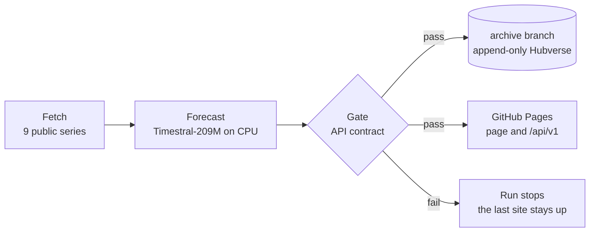

# aseri

焦り (*aseri*): impatience, restlessness. A daily forecast of geopolitical risk from nine public signals, made by Mistral's Timestral and scored against what happened.

**Live: [exdsgift.github.io/aseri](https://exdsgift.github.io/aseri/)** · **API: [exdsgift.github.io/aseri/api](https://exdsgift.github.io/aseri/api/)**


## What it forecasts

| Signal | Source | Ahead |
|---|---|---|
| Geopolitical risk, index (1985-2019 average = 100) | [Caldara and Iacoviello, GPR daily](https://www.matteoiacoviello.com/gpr.htm) | 28 days |
| "World War III", Wikipedia views a day | [Wikimedia pageviews](https://pageviews.wmcloud.org/?project=en.wikipedia.org&platform=all-access&agent=user&pages=World_War_III) | 14 days |
| Brent oil, $ a barrel | [EIA, through FRED](https://fred.stlouisfed.org/series/DCOILBRENTEU) | 14 trading days |
| Suez Canal, ships a day | [IMF PortWatch](https://portwatch.imf.org/) | 28 days |
| Strait of Hormuz, ships a day | IMF PortWatch | 14 days |
| Bab el-Mandeb, ships a day | IMF PortWatch | 14 days |
| Taiwan Strait, ships a day | IMF PortWatch | 28 days |
| Air-raid alerts in Ukraine, alert hours a day | [Ukrainian air raid sirens dataset](https://github.com/Vadimkin/ukrainian-air-raid-sirens-dataset) | 7 days |
| Drones downed, as claimed by Ukraine's General Staff | [2022 Ukraine Russia War Dataset](https://github.com/PetroIvaniuk/2022-Ukraine-Russia-War-Dataset) | 7 days |

## How it works



Every day at 07:00 UTC, [`daily.yml`](.github/workflows/daily.yml) tests the code and checks that the pinned model still gives its golden quantiles. Then it fetches each series and forecasts every new day, at 21 quantile levels, counted from the last observed day. A series that fails, runs late or lands out of bounds is held alone: its last good forecast stays up, labelled, and the run opens an issue. A change to the page alone deploys on its own, on the last run's API files.

## Why the API matters

- **Dated and append-only.** A forecast file is written once and never edited. A correction goes to the catalog's errata, and the original stays published.
- **A standard format.** Hubverse quantile output, the format public-health forecast hubs such as the CDC's and the ECDC's use, so their scoring tools read aseri as it is.
- **Its own track record.** Each series' `scores.json` gives coverage, WIS and the error against simple baselines, live and backtest apart.
- **Static and keyless.** Plain JSON on GitHub Pages, CORS open. It updates once a day: poll at most once an hour.

```sh
curl -s https://exdsgift.github.io/aseri/api/v1/series.json | jq -r '.series[].series_id'
curl -s https://exdsgift.github.io/aseri/api/v1/series/gpr_daily/latest.json | jq '{model_id, reference_date, target_end_date}'
curl -s https://exdsgift.github.io/aseri/api/v1/series/gpr_daily/scores.json | jq '{live: .live.n, needed: .min_n_to_display}'
```

```python
import json
from urllib.request import urlopen

BASE = "https://exdsgift.github.io/aseri/api/v1"
f = json.load(urlopen(f"{BASE}/series/hormuz_transits/latest.json"))
q = f["quantiles"]
for day, lo, mid, hi in zip(f["target_end_date"], q["0.1"], q["0.5"], q["0.9"]):
    print(f"{day}: likely {lo:.0f}-{hi:.0f} ships (8 in 10), middle estimate {mid:.0f}")
```

Docs, schemas and every licence: [exdsgift.github.io/aseri/api](https://exdsgift.github.io/aseri/api/) · [OpenAPI 3.1](https://exdsgift.github.io/aseri/api/v1/openapi.json) · every Hubverse file ever written: the [`archive`](https://github.com/exdsgift/aseri/tree/archive) branch.

## How good it is

> [!NOTE]
> The live record is new. A series shows its live score once 30 of its forecasts have resolved. Until then the page shows backtests, labelled as such, and never adds the two together.

- **Calibrated ranges.** The 8 in 10 range is calibrated per series on a two-year backtest, so it holds about 8 days in 10, with WIS unchanged ([ADR 0001](docs/adr/0001-baselines-and-calibration-before-the-live-record.md)). The model is `aseri-timestral209m_c1`; any change to the published ranges gets a new model ID and a fresh record.
- **Backtests may flatter the model.** Mistral has not published Timestral's training cutoff, backtest origins overlap, and only GPR has real-time vintages. On Brent, Timestral is about as good as repeating the last price.
- **Methods:** the [design spec](docs/superpowers/specs/2026-10-29-aseri-design.md) and [ADR 0001](docs/adr/0001-baselines-and-calibration-before-the-live-record.md).

## Run it locally

```sh
git clone https://github.com/exdsgift/aseri && cd aseri

# The pipeline: Python 3.12 and uv
cd pipeline && uv sync
uv run pytest
uv run python -m aseri ../site/api/v1 ../archive  # one daily run; downloads the 837 MB weights once

# The page: Node 22 and npm
cd ../web && npm ci
npm run dev  # reads the published API through a proxy
```

## Licences and credits

- **Code:** [MIT](LICENSE).
- **Forecasts, scores and the API:** [CC BY-NC 4.0](https://creativecommons.org/licenses/by-nc/4.0/), credited as "Forecasts: aseri (model aseri-timestral209m_c1, Timestral-209M by Mistral AI)".
- **Data:** each source keeps its own terms, given per series in the [catalog](https://exdsgift.github.io/aseri/api/v1/series.json) and in [`api/licenses/`](api/licenses). GPR is CC BY 4.0 (Caldara and Iacoviello, 2022, *American Economic Review*); Wikimedia pageviews CC0; Brent prices public domain (U.S. EIA); PortWatch under the IMF's terms, whose commercial use needs the IMF's permission; the two Ukraine datasets MIT (Vadym Klymenko; Petro Ivaniuk).
- **Model:** [Timestral-209M](https://huggingface.co/mistralai/Timestral-209M) by Mistral AI.
- **Engravings,** CC0 from Wikimedia Commons: Hendrick Goltzius after Polidoro da Caravaggio, *Mercury*, probably 1592, National Gallery of Art (Messenger); Hendrick Goltzius, *The Farnese Hercules*, c. 1592, published 1617, The Metropolitan Museum of Art (Signal); *Apollo Belvedere (Apollo Pythius)*, engraving, Rijksmuseum (Vortex).
- © 2026 Gabriele Durante.

## Contributing

New series, new charts and fixes: start with [CONTRIBUTING.md](CONTRIBUTING.md). Questions and ideas go to [Issues](https://github.com/exdsgift/aseri/issues).

## Support

If aseri is useful to you, [buy me a coffee](https://buymeacoffee.com/exdsgift). Find me on [GitHub](https://github.com/exdsgift) and [LinkedIn](https://www.linkedin.com/in/gabrieledurante/).
